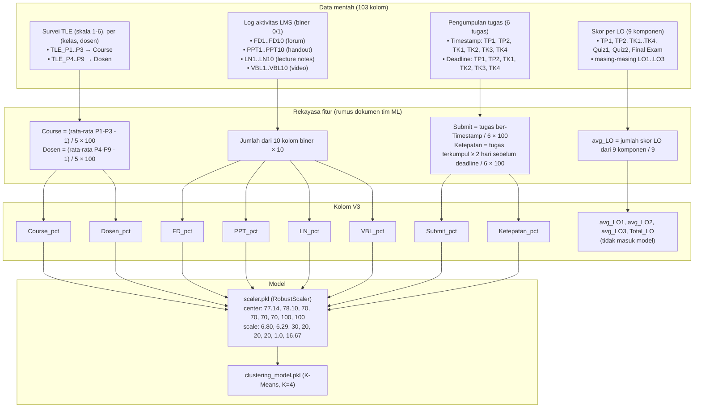

# 📊 Analisis Data Pendukung Tambahan (Dataset Mentah, Kamus Data, dan Fitur Clustering V3)

> [!NOTE]
> **Direvisi 20 November 2026.** Versi sebelumnya memuat rumus TLE, definisi Ketepatan, dan klaim yang tidak sesuai dengan dokumen tim ML maupun data. Koreksinya dirangkum di bagian 5.
> Untuk status keputusan, pertanyaan terbuka, dan hasil verifikasi terbaru, rujukan utamanya adalah **bagian 0 [ANALISIS_FEEDBACK_DAN_RANCANGAN_V2.md](ANALISIS_FEEDBACK_DAN_RANCANGAN_V2.md)**. Jika ada perbedaan, dokumen itu yang berlaku.

Dokumen ini membahas tiga file data dan satu dokumen rumus:

1. **`Dataset Documentation - Copy.docx`**: kamus data (103 kolom) dan aturan evaluasi TLE.
2. **`Completed_Students_Dataset_All_Cleaned.xlsx`**: data mentah 5.725 baris × 103 kolom. Satu baris adalah satu mahasiswa di satu kelas. Isinya **583 NIM unik**, 79 kode kelas, 42 dosen, dan 270 kombinasi (periode, kelas, mata kuliah).
3. **`Dataset_Student_Clustering_V3.xlsx`**: data hasil rekayasa fitur, 5.725 baris × 18 kolom, dengan urutan baris yang sama dengan data mentah. Ini data latih model (`scaler.pkl` dan `clustering_model.pkl`).
4. **`Feature Engineering Formulas.docx`**: rumus resmi dari tim ML.

File-file tersebut ada di folder `assets/` dan belum di-commit.

---

## 1. Dari 103 Kolom Mentah ke 8 Fitur Model

Urutan 8 fitur di atas sama dengan urutan yang dipakai `scaler.pkl` dan `clustering_model.pkl`. Hanya 8 fitur ini yang masuk model; kolom `avg_LO` dan `Total_LO` tidak.

---

## 2. Rumus dan Kamus Data

Sumber: `Feature Engineering Formulas.docx` dan `Dataset Documentation - Copy.docx`.

### A. Aktivitas LMS

Aktivitas dicatat biner (`1` = dilakukan, `0` = tidak). Ada empat jenis, masing-masing 10 kolom. Angka 1..10 adalah **urutan aktivitas** (forum ke-1 sampai ke-10, dan seterusnya), **bukan nomor sesi**.

$$\text{FD\_pct} = \left(\sum_{i=1}^{10} \text{FD}_i\right) \times 10$$

Rumus yang sama berlaku untuk `PPT_pct`, `LN_pct`, dan `VBL_pct`.

> ⚠️ **Belum terjawab:** pemetaan 10 aktivitas ini ke 16 sesi. `Student Activities.xlsx` menyebut aktivitas pada beberapa sesi, tetapi penomoran FD/PPT/LN/VBL ke sesi belum konsisten dan belum dikonfirmasi.

### B. Pengumpulan tugas

Ada 6 tugas dengan Timestamp dan Deadline: `TP1`, `TP2`, `TK1`, `TK2`, `TK3`, `TK4`.

$$\text{Submit\_pct} = \frac{\text{jumlah tugas dengan Timestamp tidak kosong}}{6} \times 100$$

$$\text{Ketepatan\_pct} = \frac{\text{jumlah tugas dikumpulkan minimal 2 hari sebelum deadline}}{6} \times 100$$

Hasil pemeriksaan data: deadline konstan dalam satu kelas, dan **tidak ada satu pun pengumpulan yang melewati deadline**.

> ⚠️ **Tidak cocok dengan V3:** V3 tampaknya menganggap Timestamp kosong pada TK2 dan TK4 sebagai "sudah dikumpulkan" dan "tepat waktu". Rumus dokumen secara harfiah memindahkan 72,7% mahasiswa ke klaster lain. Lihat bagian 4.

### C. TLE (evaluasi pengajaran)

Skala **1–6**. Nilai TLE melekat pada **(kelas, dosen)**, bukan per mahasiswa. Tiga kelas diajar dua dosen dan memiliki vektor TLE berbeda per dosen.

$$\text{Course\_pct} = \frac{\overline{\text{TLE}_{P1..P3}} - 1}{5} \times 100$$

$$\text{Dosen\_pct} = \frac{\overline{\text{TLE}_{P4..P9}} - 1}{5} \times 100$$

TLE diisi di Sesi 16, sehingga dua fitur ini belum ada sebelum akhir semester.

### D. Skor LO dan nilai maksimal

| Asesmen | Sesi | LO1 | LO2 | LO3 |
| :--- | :-: | :-: | :-: | :-: |
| TP1 | 3 | 100 | 0 | 0 |
| TK1 | 4 | 100 | 0 | 0 |
| TK2 | 5 | 0 | 100 | 0 |
| Quiz 1 | 6 | 80 | 20 | 0 |
| TP2 | 11 | 20 | 80 | 0 |
| TK3 | 12 | 0 | 60 | 40 |
| TK4 | 13 | 0 | 50 | 50 |
| Quiz 2 | 14 | 0 | 40 | 60 |
| Final Exam | 16 | 20 | 40 | 40 |

Sesi dari `Student Activities.xlsx`; nilai maksimal dari kamus data. Angka-angka ini berlaku untuk skema LO1–LO3 standar.

$$\text{avg\_LO}_k = \frac{\sum_{9\ \text{komponen}} \text{skor LO}_k}{9}, \qquad \text{Total\_LO} = \text{avg\_LO}_1 + \text{avg\_LO}_2 + \text{avg\_LO}_3$$

Kolom `avg_LO1..3` dan `Total_LO`, ditambah `Course_pct`, `Dosen_pct`, `PPT_pct`, dan `LN_pct`, **sama persis** dengan V3 pada seluruh 5.725 baris.

---

## 3. Dampak pada Rancangan Sistem

### 1. Template bulk import

Template sebaiknya mengikuti **data mentah** (Timestamp, Deadline, FD1..VBL10, skor per LO, TLE), bukan kolom persentase V3. Dengan begitu backend menghitung fitur sendiri dari satu aturan yang jelas, dan hasilnya bisa dilacak. V3 sudah mengandung penyimpangan yang belum dijelaskan, sehingga tidak layak dijadikan format masukan.

### 2. Data riil sebagai data awal

Dataset ini dapat dipakai sebagai data awal pengujian dan demo. Per 20 November 2026 pemilik proyek menyatakan izin pemakaian sudah ada. Dataset tetap berada di `assets/` dan **belum di-commit ke repositori**. Perlu diingat:

- 5.725 baris berarti 5.725 **keanggotaan kelas**, bukan 5.725 mahasiswa. Mahasiswa unik ada 583, dan 473 di antaranya muncul di lebih dari satu kelas.
- Klaster dihitung per (mahasiswa, kelas), bukan per mahasiswa.
- Kode mata kuliah muncul dalam dua varian (mis. `ISYS6300` dan `ISYS6300035`). Keputusan penyimpanannya ada di bagian 0-D dokumen V2.

### 3. Aturan status mahasiswa (masih usulan)

Pada versi sebelumnya dokumen ini menulis ambang berikut seolah sudah pasti. **Tidak ada dokumen atau konfirmasi dosen yang menetapkannya.** Anggap ini bahan diskusi:

| Status usulan | Kondisi usulan |
| :--- | :--- |
| Perlu Perhatian | `Submit_pct` < 80, atau `Ketepatan_pct` < 60, atau rata-rata aktivitas LMS < 60 |
| Monitoring | salah satu capaian LO di bawah batas ketuntasan |

Batas ketuntasan LO pun belum pasti: prototipe UI memakai 60, draf SQL memakai 65. Selain itu, karena `Submit_pct` dan `Ketepatan_pct` di V3 memberi kredit pada TK2/TK4 yang kosong, ambang ini harus dihitung ulang setelah aturan pastinya diketahui.

### 4. Hubungan dengan `Rekomendasi Prodi.xlsx`

Distribusi klaster K=4 berdasarkan centroid terdekat pada data V3:

| Klaster | Profil | Jumlah baris | Persentase |
| :-: | :--- | :-: | :-: |
| C0 | High Achievement & Consistent Engagement | 4.820 | 84,19% |
| C2 | Developing Learning Engagement & LO Attainment | 559 | 9,76% |
| C3 | Learning Engagement & Achievement Improvement | 286 | 5,00% |
| C1 | Critical Engagement & Assessment Support | 60 | 1,05% |

Catatan: angka ini dihitung dari centroid, belum dengan memuat `clustering_model.pkl` secara langsung. Gambar distribusi pada `UI Dashboard nm.docx` hanyalah contoh tampilan dan tidak dipakai sebagai acuan.

---

## 4. Temuan yang Belum Terjelaskan

Semua temuan ini ditanyakan ke tim ML dan dosen (bagian 0-E dokumen V2).

1. **`FD_pct` dan `VBL_pct` di V3 menyimpang dari rumus** pada 684 dan 666 baris (±12%). Contoh: FD1..FD10 berisi sembilan angka 1 dan satu angka 0, rumus memberi 90, V3 menulis 40.
2. **`Submit_pct` dan `Ketepatan_pct` di V3 menyimpang** pada 4.263 dan 4.112 baris. Dugaan yang belum dikonfirmasi: Timestamp TK2/TK4 yang kosong dihitung "sudah dikumpulkan" dan "tepat waktu". Dugaan itu cocok pada sekitar 96% (Submit) dan 90% (Ketepatan) baris, sisanya belum terjelaskan.
3. **Semua 40 kolom aktivitas berpartisipasi sekitar 70%** (rentang 68,6–71,3%), termasuk kolom untuk sesi yang tidak punya forum, dan tidak turun di sesi akhir seperti pola log LMS pada umumnya. Perlu dipastikan apakah ini log asli.
4. **Alasan memilih K-Means.** Pada konfigurasi yang sama, DBSCAN punya Silhouette dan DBI lebih baik (0,862 dan 0,179 dibanding 0,842 dan 0,341 untuk K-Means K=4), tetapi 9,2% mahasiswa menjadi noise.

---

## 5. Koreksi atas Versi Sebelumnya

| Pernyataan di versi lama | Yang benar |
| :--- | :--- |
| TLE `P1..P4` untuk Course dan `P5..P9` untuk Dosen | `P1..P3` untuk Course, `P4..P9` untuk Dosen |
| Skala TLE 0–6 | Skala 1–6, rumus `(rata-rata − 1) / 5 × 100` |
| Aktivitas LMS dicatat pada "10 sesi" | FD/PPT/LN/VBL adalah 10 aktivitas per jenis. Pemetaannya ke 16 sesi belum pasti |
| `Ketepatan_pct` = Timestamp ≤ Deadline | Dikumpulkan minimal 2 hari sebelum deadline |
| Seluruh V3 mengikuti rumus dokumen | Kolom LO, `Course_pct`, `Dosen_pct`, `PPT_pct`, dan `LN_pct` cocok persis; empat kolom (`FD_pct`, `VBL_pct`, `Submit_pct`, `Ketepatan_pct`) menyimpang |
| V3 layak dijadikan template import | Template memakai data mentah; V3 menyimpang dari rumus |
| 5.725 "data riil mahasiswa" | 5.725 baris keanggotaan kelas dari 583 mahasiswa unik |
| Ambang status Perlu Perhatian dan Monitoring (tertulis sebagai aturan) | Usulan saja, belum dikonfirmasi |
| "Tidak ada lagi data yang bertolak belakang" dengan dokumen UI | Dokumen UI hanya contoh tampilan; distribusi dihitung dari centroid |
