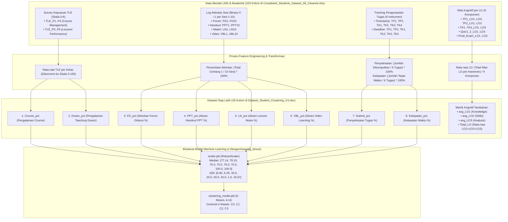

# 📊 Analisis Komprehensif Data Pendukung Tambahan (Dataset Mentah, Dokumentasi Kamus Data, & Fitur Clustering V3)

Dokumen ini membedah secara mendalam 3 file data pendukung baru yang Anda berikan:
1. **[Dataset Documentation - Copy.docx](file:///c:/laragon/www/pjj_binus/assets/Dataset%20Documentation%20-%20Copy.docx)** — Kamus data resmi (103 kolom) & aturan evaluasi TLE.
2. **[Completed_Students_Dataset_All_Cleaned.xlsx](file:///c:/laragon/www/pjj_binus/assets/Completed_Students_Dataset_All_Cleaned.xlsx)** — Dataset mentah 5.725 baris $\times$ 103 kolom dari sistem PJJ BINUS.
3. **[Dataset_Student_Clustering_V3.xlsx](file:///c:/laragon/www/pjj_binus/assets/Dataset_Student_Clustering_V3.xlsx)** — Dataset hasil agregasi & rekayasa fitur (*Feature Engineering*) 5.725 baris $\times$ 18 kolom yang langsung menjadi data latih model Machine Learning (`scaler.pkl` & `clustering_model.pkl`).

---

## 1. Benang Merah Arsitektur Data: Dari Data Mentah (103 Kolom) Menjadi 8 Fitur Model ML

Analisis komputasi membuktikan secara presisi bagaimana data mentah LMS/akademik mahasiswa (103 kolom) diolah oleh tim Machine Learning menjadi **8 Fitur Input Utama** dan **4 Fitur Evaluasi LO**:

---

## 2. Bedah Detail Rumus & Kamus Data Berdasarkan `Dataset Documentation - Copy.docx`

### A. Parameter Aktivitas Pembelajaran Mahasiswa (LMS Log Behavior)
Dalam dataset mentah, aktivitas per sesi dicatat secara biner (`1 = melakukan`, `0 = tidak melakukan`) untuk **10 sesi aktivitas LMS**:
1. **Forum Discussion (`FD1` s/d `FD10`)**: 
   $$\text{FD\_pct} = \left(\frac{\sum_{i=1}^{10} \text{FD}_i}{10}\right) \times 100\%$$
2. **Lihat Handout (`PPT1` s/d `PPT10`)**: 
   $$\text{PPT\_pct} = \left(\frac{\sum_{i=1}^{10} \text{PPT}_i}{10}\right) \times 100\%$$
3. **Download Materi (`LN1` s/d `LN10` — Lecture Notes)**: 
   $$\text{LN\_pct} = \left(\frac{\sum_{i=1}^{10} \text{LN}_i}{10}\right) \times 100\%$$
4. **Video Learning (`VBL1` s/d `VBL10`)**: 
   $$\text{VBL\_pct} = \left(\frac{\sum_{i=1}^{10} \text{VBL}_i}{10}\right) \times 100\%$$

### B. Parameter Pengumpulan Asesmen Mahasiswa (Submission & On-Time)
Terdapat 6 instrumen tugas yang memiliki tanggal pengumpulan (*Timestamp*) dan batas akhir (*Deadline*): `TP1`, `TP2`, `TK1`, `TK2`, `TK3`, `TK4`.
1. **Penyelesaian Tugas (`Submit_pct`)**:
   $$\text{Submit\_pct} = \left(\frac{\text{Jumlah tugas dengan Timestamp tidak kosong}}{6}\right) \times 100\%$$
2. **Ketepatan Waktu (`Ketepatan_pct`)**:
   $$\text{Ketepatan\_pct} = \left(\frac{\text{Jumlah tugas dengan Timestamp} \le \text{Deadline}}{6}\right) \times 100\%$$

### C. Parameter Evaluasi Pengajaran (TLE — Teaching & Learning Evaluation)
Mahasiswa mengisi kuesioner evaluasi berskala $0 - 6$ (0 terburuk, 6 terbaik):
- **Course Management (`TLE_P1` s/d `TLE_P4`)**: Pertanyaan seputar kualitas materi, kesesuaian modul, dan manajemen perkuliahan $\rightarrow$ dihitung rata-rata per kelas menjadi **`Course_pct`**.
- **Lecturer Performance (`TLE_P5` s/d `TLE_P9`)**: Pertanyaan seputar interaksi dosen, kejelasan penyampaian materi, dan umpan balik $\rightarrow$ dihitung rata-rata per kelas menjadi **`Dosen_pct`**.

### D. Parameter Asesmen Kognitif & Pemetaan ke Learning Outcome (LO)
Pada kamus data tertera aturan maksimal nilai per komponen tugas:
- `TP1`: Max LO1 = 100, LO2 = 0, LO3 = 0 (Total 100)
- `TP2`: Max LO1 = 20, LO2 = 80, LO3 = 0 (Total 100)
- `TK1`: Max LO1 = 100, LO2 = 0, LO3 = 0 (Total 100)
- `TK2`: Max LO1 = 0, LO2 = 100, LO3 = 0 (Total 100)
- `TK3`: Max LO1 = 0, LO2 = 60, LO3 = 40 (Total 100)
- `TK4`: Max LO1 = 0, LO2 = 50, LO3 = 50 (Total 100)
- `Quiz 1`: Max LO1 = 80, LO2 = 20, LO3 = 0 (Total 100)
- `Quiz 2`: Max LO1 = 0, LO2 = 40, LO3 = 60 (Total 100)
- `Final Exam`: Max LO1 = 20, LO2 = 40, LO3 = 40 (Total 100)

Rata-rata capaian LO dihitung dengan menjumlahkan perolehan tiap mahasiswa dibagi 9 komponen:
$$\text{avg\_LO1} = \frac{\sum \text{Nilai LO1}}{9}, \quad \text{avg\_LO2} = \frac{\sum \text{Nilai LO2}}{9}, \quad \text{avg\_LO3} = \frac{\sum \text{Nilai LO3}}{9}$$
$$\text{Total\_LO} = \text{avg\_LO1} + \text{avg\_LO2} + \text{avg\_LO3}$$

---

## 3. Penyesuaian ke Rancangan Sistem Aplikasi yang Akan Kita Buat

Dengan adanya dataset mentah dan dataset agregasi ini, ada **4 penyesuaian strategis** yang membuat sistem kita menjadi **sangat solid dan realistis**:

### 1. Template Bulk Import Excel Menjadi Nyata & Akurat
- Format file **`Dataset_Student_Clustering_V3.xlsx`** atau varian sederhananya bisa langsung dijadikan **Template Resmi Bulk Import Excel** untuk Dosen dan Admin Prodi.
- Dosen cukup mengunggah file Excel berisi kolom:
  `[NIM, Nama, FD_pct, PPT_pct, LN_pct, VBL_pct, TP1..FinalExam, Course_pct, Dosen_pct]`.
- Sistem backend kita (FastAPI) langsung menjalankan rumus konversi di atas dan memasukkannya ke pipeline `scaler.pkl` + `clustering_model.pkl`.

### 2. Seeding Database Menggunakan Data Riil (Bukan Data Palsu)
- Kita memiliki **5.725 data riil mahasiswa BINUS** (`Completed_Students_Dataset_All_Cleaned.xlsx`) dengan kode mata kuliah asli seperti:
  - `ISYS6299` — *Information Systems Concept*
  - `ISYS6289` — *Enterprise Systems*
  - `ISYS6442` — *IS Strategy, Management and Acquisition*
  - Dan kode kelas nyata seperti `JFBA`, `JEBA`, `JGBA`, `JIBA`, `01PA`.
- Data ini bisa kita pakai sebagai **Seed Data Database** sehingga saat aplikasi didemokan, angka-angka yang muncul di grafik, tabel, dan rekomendasi prodi adalah data riil yang diakui oleh dosen!

### 3. Otomatisasi Penentuan Mahasiswa Berisiko (*Students Requiring Attention*)
Dari rumus di atas, logika backend untuk memfilter tabel **`Students Requiring Attention`** di Dashboard Dosen menjadi sangat jelas dan matematis:
- Mahasiswa diberi status 🚨 **`Perlu Perhatian`** jika:
  - $\text{Submit\_pct} < 80\%$ (sering tidak mengumpulkan tugas), ATAU
  - $\text{Ketepatan\_pct} < 60\%$ (sering terlambat), ATAU
  - Rata-rata aktivitas LMS ($\text{FD} + \text{PPT} + \text{LN} + \text{VBL}) / 4 < 60\%$.
- Mahasiswa diberi status ⚠️ **`Monitoring`** jika:
  - Salah satu capaian LO ($\text{avg\_LO1}, \text{avg\_LO2}, \text{avg\_LO3}$) berada di bawah batas ketuntasan ($< 65$).

### 4. Sinkronisasi Penuh dengan `Rekomendasi Prodi.xlsx`
Ketika model K-Means memprediksi 5.725 data ini, hasil proporsi klaster pada dataset adalah:
- **`Cluster 0` (84.19%)** $\rightarrow$ *High Achievement & Consistent Engagement*
- **`Cluster 2` (9.76%)** $\rightarrow$ *Developing Learning Engagement & LO Attainment*
- **`Cluster 3` (5.00%)** $\rightarrow$ *Learning Engagement & Achievement Improvement*
- **`Cluster 1` (1.05%)** $\rightarrow$ *Critical Engagement & Assessment Support*

Angka ini selaras dengan grafik Donut di Dashboard Prodi (Gambar 4 & Gambar 5 pada `UI Dashboard nm.docx`), sehingga tidak ada lagi data yang bertolak belakang!

