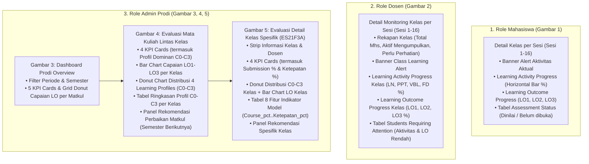
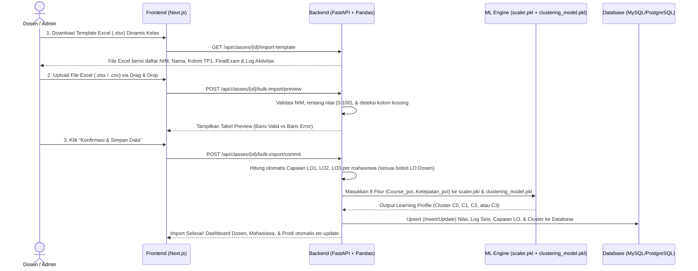
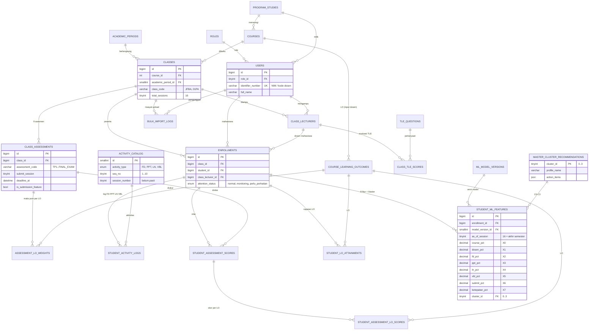

# 📘 Analisis Feedback Dosen, Bedah UI Baru (`UI Dashboard nm.docx`), RBAC, & Rancangan Ulang Database (v2.1)

Dokumen ini merangkum hasil analisis mendalam terhadap *feedback* terbaru dosen pemilik proyek, dokumen desain **[UI Dashboard nm.docx](file:///c:/laragon/www/pjj_binus/assets/UI%20Dashboard%20nm.docx)**, matriks **[Rekomendasi Prodi.xlsx](file:///c:/laragon/www/pjj_binus/assets/Rekomendasi%20Prodi.xlsx)**, serta evaluasi pemodelan **[Summary Modeling Clustering all.xlsx](file:///c:/laragon/www/pjj_binus/assets/Summary%20Modeling%20Clustering%20all.xlsx)**.

---

## 0. Status Dokumen & Keputusan yang Perlu Persetujuan

> [!NOTE]
> **Status: DRAFT menunggu persetujuan.** Tahap 2 (skema database) sudah ditulis di **[database_schema_v2.sql](database_schema_v2.sql)** (22 tabel, 2 view, seed referensi). File lama `database_schema.sql` (v1) **sengaja belum ditimpa**. Setelah Anda setujui, v1 akan diganti atau diarsipkan.

### A. Yang sudah terverifikasi terhadap data riil
Semua angka di bawah dihitung langsung dari `Completed_Students_Dataset_All_Cleaned.xlsx` dan `Dataset_Student_Clustering_V3.xlsx` (5.725 baris), bukan disalin dari dokumen lain.

| Temuan | Bukti |
| :--- | :--- |
| Sesi 1–16 adalah struktur resmi | `Student Activities.xlsx` |
| Jadwal asesmen: TP1→S3, TK1→S4, TK2→S5, Quiz1→S6, TP2→S11, TK3→S12, TK4→S13, Quiz2→S14, Final Exam & TLE→S16 | `Student Activities.xlsx` (berbeda dari prototipe `index.html`: TK4 di sesi 13, Quiz 1 di sesi 6) |
| Model resmi: **K-Means, 8 fitur, RobustScaler, K=4** | Dikonfirmasi pemilik proyek; `Summary Modeling Clustering all.xlsx` sheet K-Means baris 31 |
| `Course_pct`, `Dosen_pct`, `PPT_pct`, `LN_pct`, `avg_LO1..3`, `Total_LO` di V3 **sama persis** dengan rumus tim ML | Dihitung ulang pada 5.725 baris, selisih 0 |
| TLE bernilai per **(kelas, dosen)**, bukan per mahasiswa | 267 dari 270 kelas punya satu vektor TLE; 3 kelas dua-dosen punya vektor berbeda per dosen |
| Deadline tugas konstan per kelas | 0 dari 270 kelas punya deadline TP1 ganda |
| Distribusi klaster K=4 pada V3: **4.820 / 559 / 286 / 60** mahasiswa (C0 84,19% · C2 9,76% · C3 5,00% · C1 1,05%) | Nearest-centroid memakai centroid yang disalin di `ml_visualization.html` (bukan memuat `.pkl` langsung) |
| Model dilatih pada fitur yang **mengkredit TK2/TK4 kosong** sebagai terkumpul dan tepat waktu | Memakai rumus dokumen apa adanya, hanya 118 dari 200 label `.pkl` yang cocok dan **72,7% mahasiswa pindah klaster** (C0 turun 84% → 20,5%). Dengan aturan kredit TK2/TK4: 186 dari 200 cocok, distribusi 85,9 / 0,4 / 8,9 / 4,8 |
| TK2 dan TK4 bertingkah seperti tugas opsional | Kredit untuk **semua** TK2/TK4 kosong cocok dengan V3 di 95,9% (Submit) dan 90,4% (Ketepatan); kredit hanya untuk kelas yang kosong penuh hanya 70%. TK2 kosong satu kelas penuh di 136 dari 270 kelas, TK4 di 116; TP1/TK1/TK3 hampir tidak pernah (3/2/3 kelas) |
| Satu mahasiswa muncul di banyak kelas | 583 NIM unik, 473 di antaranya punya lebih dari satu baris |

### B. Koreksi atas isi dokumen ini dan dokumen analisis sebelumnya
Hasil pembacaan `Feature Engineering Formulas.docx` dan verifikasi data mengubah beberapa pernyataan lama:

| Pernyataan lama | Yang benar |
| :--- | :--- |
| `Course_pct` dari TLE P1–P4, `Dosen_pct` dari TLE P5–P9 | `Course_pct` = TLE **P1–P3**; `Dosen_pct` = TLE **P4–P9** |
| Skala TLE 0–6 | Skala **1–6**: `(rata-rata − 1) / 5 × 100` |
| `Ketepatan_pct` = Timestamp ≤ Deadline | `Ketepatan_pct` = dikumpulkan **minimal 2 hari sebelum deadline**. Tidak ada satu pun pengumpulan melewati deadline di seluruh data. |
| K-Means dipilih karena Silhouette tertinggi dan DBI terendah dibanding semua algoritma | **Tidak terverifikasi.** Pada konfigurasi yang sama (8 fitur, Robust), DBSCAN lebih tinggi (Silhouette 0,862, DBI 0,179) tetapi 9,2% mahasiswa menjadi *noise*. Alasan pemilihan K-Means perlu dikonfirmasi tim ML. |
| Distribusi klaster `84.19 : 1.97 : 13.83` untuk K=4 | Itu distribusi **K=3** di file ringkasan. Distribusi K=4 (84,19 / 9,76 / 5,00 / 1,05) tidak ada di file itu, tetapi **terverifikasi** dari centroid dan V3 (lihat 0-A). |
| Aktivitas LMS adalah "10 sesi" | Kolom `FD1..FD10` dst. adalah **forum/handout/notes/video ke-1..10**, bukan sesi. Pemetaannya ke Sesi 1–16 **belum jelas** (lihat keputusan 1). |

### C. Temuan yang belum bisa dijelaskan (perlu jawaban tim ML)
1. **`FD_pct` dan `VBL_pct` di V3 menyimpang dari rumus** pada 684 dan 666 baris (±12%). Contoh: Excel baris 16 (NIM 124081701, JFBA, ISYS6299) punya `FD1..FD10` = sembilan angka 1 dan satu angka 0 → rumus 90, tetapi V3 menulis 40. Baris 103 (NIM 124100330): `VBL1..VBL10` semuanya 1 → rumus 100, V3 menulis 30.
2. **`Submit_pct` dan `Ketepatan_pct` di V3 berbeda dari rumus dokumen** pada 4.263 dan 4.112 baris. Contoh baris 7 (NIM 124078502): `Timestamp_TK2` kosong, rumus dokumen 83,33, V3 menulis 100. **Bukan sekadar selisih angka:** model `.pkl` ternyata dilatih pada fitur V3. Dengan rumus dokumen apa adanya, 72,7% mahasiswa jatuh ke klaster yang berbeda. Aturan yang paling cocok dengan V3: TK2 dan TK4 yang kosong dianggap sudah dikumpulkan dan tepat waktu (opsional). Ini masih **dugaan terbaik**, belum dikonfirmasi tim ML; sisa 4% (Submit) dan 10% (Ketepatan) tidak terjelaskan.
3. **Semua 40 kolom aktivitas berpartisipasi ±70%** (rentang 68,6–71,3%), termasuk `FD8` walaupun Sesi 8 tidak punya forum. Tidak ada penurunan di sesi akhir seperti log LMS pada umumnya. Perlu dipastikan apakah ini log asli.

### D. Keputusan yang perlu Anda setujui
Tanda `[ASUMSI-n]` di file SQL merujuk ke nomor berikut.

| No | Keputusan | Default di draft SQL | Setuju? |
| :-: | :--- | :--- | :-: |
| 1 | Pemetaan `FDn/PPTn/LNn/VBLn` ke sesi | Tabel `activity_catalog` **dikosongkan**; tersedia dua opsi seed (komentar di akhir SQL). Struktur tidak berubah apa pun jawabannya. | ☐ |
| 2 | TK2 dan TK4 | **Opsional**: kolom `class_assessments.is_optional = 1`. Bila tidak dikumpulkan dihitung terkumpul dan tepat waktu. Keenam baris asesmen tetap dibuat di setiap kelas. | ☐ |
| 3 | `Submit_pct`/`Ketepatan_pct` mengikuti | **Perilaku V3** (dengan aturan opsional di atas), **bukan** rumus dokumen apa adanya, supaya klaster konsisten dengan model `.pkl`. *Ini membalik default draf sebelumnya.* | ☐ |
| 4 | Batas ketuntasan LO | SQL: 65 (angka dari analisis awal). **UI saat ini memakai 60** (dari desain UI). Keduanya belum dikonfirmasi; perlu satu angka resmi | ☐ |
| 5 | Klaster sebelum Sesi 16 | Kolom `as_of_session` default 16 (akhir semester); fitur boleh `NULL` karena TLE baru terisi di Sesi 16. Klaster tengah semester **belum dihitung** | ☐ |
| 6 | Kode mata kuliah `ISYS6300` vs `ISYS6300035` | Disimpan apa adanya sebagai dua mata kuliah berbeda | ☐ |
| 7 | Satuan klaster | Satu klaster per **(mahasiswa, kelas)** = per `enrollment` | ☐ |
| 8 | Data riil di database | Seed hanya data referensi. Dataset 583 NIM diimpor lewat bulk import setelah anonimisasi dikonfirmasi | ☐ |

### E. Pertanyaan untuk dosen / tim ML
1. Pada V3, kenapa `FD_pct`/`VBL_pct` tidak sama dengan rumus di baris 16 dan 103? Adakah proses tambahan?
2. Pada baris 7, `Timestamp_TK2` kosong tetapi `Submit_pct` = 100. Apakah benar TK2 dan TK4 bersifat opsional (kosong dianggap terkumpul dan tepat waktu)? Dugaan kami cocok dengan V3 di 95,9% / 90,4% baris; apa penyebab sisanya?
3. `FD1..FD10`, `PPT1..PPT10`, `VBL1..VBL10` adalah sesi berapa? `FDn` = Sesi n (hanya Sesi 1–10), atau mengikuti tabel kiri `Student Activities.xlsx`? Apakah ada `FD11..FD15`?
4. Apakah kolom aktivitas LMS berasal dari log asli? Partisipasi ±70% di semua kolom.
5. Kenapa K-Means dipilih padahal DBSCAN punya Silhouette dan DBI lebih baik pada konfigurasi yang sama?
6. Bagaimana klaster dan alert ditampilkan sebelum Sesi 16, saat TLE belum ada?
7. Apa arti `Kode_Periode` (2011, 2221, 2421, ...), dan format kode kelas resmi (`JFBA` atau `01PA`)?
8. Bolehkah dataset 583 NIM dipakai sebagai data demo dan diunggah ke GitHub/Vercel? Sudahkah dianonimkan?

---

## 1. Bedah Perubahan Desain pada `UI Dashboard nm.docx` & Temuan Kunci

Berdasarkan ekstraksi 5 gambar desain terbaru di dalam `UI Dashboard nm.docx`, terdapat **evolusi penting** dibandingkan rancangan awal. Yang paling krusial: **ke-8 nama fitur asli pada model Machine Learning (`scaler.pkl` & `clustering_model.pkl`) kini terungkap secara eksplisit pada layar Detail Kelas Prodi!**   

### A. Terungkapnya 8 Fitur Asli Model Machine Learning (`.pkl`)
Pada Gambar 5 (*Detail Kelas — ES21F3A*), tertulis bahwa model menggunakan **K-Means Clustering (`8 Fitur, RobustScaler`)** dengan rincian ke-8 fitur yang **100% cocok hingga angka desimalnya** dengan titik pusat `Cluster 0` di dalam file `clustering_model.pkl`:

| Urutan Fitur di `.pkl` | Nama Variabel Fitur | Label Indikator di UI | Median `scaler.pkl` (`center_`) | IQR `scaler.pkl` (`scale_`) | Nilai Centroid `Cluster 0` |
| :---: | :--- | :--- | :---: | :---: | :---: |
| **Fitur 1 (`X[0]`)** | `Course_pct` | Pengalaman Course / LMS | `77.14` | `6.80` | **`76.9%`** (`76.88`) |
| **Fitur 2 (`X[1]`)** | `Dosen_pct` | Pengalaman Teaching / Dosen | `78.10` | `6.29` | **`77.5%`** (`77.48`) |
| **Fitur 3 (`X[2]`)** | `FD_pct` | Aktivitas Forum Diskusi | `70.00` | `30.00` | **`69.9%`** (`69.88`) |
| **Fitur 4 (`X[3]`)** | `PPT_pct` | Akses Materi Presentasi | `70.00` | `20.00` | **`70.3%`** (`70.34`) |
| **Fitur 5 (`X[4]`)** | `LN_pct` | Akses Materi Learning / Navigasi | `70.00` | `20.00` | **`70.3%`** (`70.26`) |
| **Fitur 6 (`X[5]`)** | `VBL_pct` | Aktivitas Video Learning | `70.00` | `20.00` | **`69.9%`** (`69.94`) |
| **Fitur 7 (`X[6]`)** | `Submit_pct` | Penyelesaian Tugas (*Submission*) | `100.00` | `1.00` | **`100.0%`** (`100.00`) |
| **Fitur 8 (`X[7]`)** | `Ketepatan_pct` | Ketepatan Pengumpulan (*On-Time*) | `100.00` | `16.67` | **`93.1%`** (`93.07`) |

> [!IMPORTANT]
> Dari file `Summary Modeling Clustering all.xlsx` (Sheet `K-Means`, Baris 31), kombinasi **8 Features + Robust Scaler + K-Means ($K=4$)** menghasilkan **Silhouette `0.84195`** dan **Davies-Bouldin Index (DBI) `0.34072`** (K=4). Pemilik proyek mengonfirmasi inilah model yang dipakai. *Catatan koreksi:* klaim sebelumnya bahwa angka ini "tertinggi/terendah dibanding semua algoritma" **tidak terverifikasi**; DBSCAN pada konfigurasi yang sama memberi Silhouette 0,862 dan DBI 0,179 dengan 9,2% data sebagai *noise* (lihat bagian 0-B).

---

### B. Matriks 4 Learning Profiles (`Rekomendasi Prodi.xlsx`)
Pada `UI Dashboard nm.docx` dan `Rekomendasi Prodi.xlsx`, output klaster `0, 1, 2, 3` dari `clustering_model.pkl` kini memiliki nama profil resmi dan rekomendasi strategis untuk Prodi:

| Kode Klaster | Nama Learning Profile | Warna UI | Karakteristik Empiris (`Rekomendasi Prodi.xlsx`) | Arahan & Fokus Rekomendasi Strategis (Semester Berikutnya) |
| :---: | :--- | :---: | :--- | :--- |
| **`C0`**<br>*(Cluster 0)* | **High Achievement & Consistent Engagement** | 🟢 Hijau | Rata-rata Total LO tertinggi, disertai *submission* dan ketepatan waktu yang tinggi. | **Maintain and Optimize Course Design**<br>1. Pertahankan struktur pembelajaran yang sudah berjalan.<br>2. Identifikasi LO yang masih bisa ditingkatkan. |
| **`C1`**<br>*(Cluster 1)* | **Critical Engagement & Assessment Support** | 🔴 Merah | Rata-rata Total LO terendah, disertai *engagement* forum & VBL serta *submission* dan ketepatan waktu yang rendah. | **Prioritize Course Redesign Review**<br>1. Evaluasi struktur *course* pada LMS, kualitas dan relevansi materi dengan LO.<br>2. Evaluasi kejelasan instruksi tugas.<br>3. Tinjau keselarasan materi–aktivitas–*assessment*. |
| **`C2`**<br>*(Cluster 2)* | **Developing Learning Engagement & LO Attainment** | 🔵 Biru | Rata-rata Total LO di bawah Cluster 0, dengan *submission* relatif tinggi dan *engagement* pada tingkat menengah. | **Improve Learning Effectiveness and Assessment Alignment**<br>1. Identifikasi LO yang relatif lebih rendah.<br>2. Tinjau keselarasan materi–aktivitas–*assessment* dengan LO.<br>3. Perkuat aktivitas Forum Diskusi dan VBL yang relevan dengan LO. |
| **`C3`**<br>*(Cluster 3)* | **Learning Engagement & Achievement Improvement** | 🟡 Kuning | Rata-rata Total LO relatif rendah, disertai *engagement* dan ketepatan waktu yang belum optimal. | **Improve Learning Activities and Course Structure**<br>1. Evaluasi urutan materi dan relevansinya dengan LO.<br>2. Tingkatkan kualitas Forum Diskusi menjadi ruang interaksi.<br>3. Evaluasi kejelasan instruksi dan rubrik penilaian tugas. |

---

### C. Bedah Detail 5 Layar Baru pada `UI Dashboard nm.docx`



#### Ringkasan Perubahan Penting per Role di `UI Dashboard nm.docx`:
1. **Dashboard Mahasiswa (Gambar 1)**:
   - **Tidak lagi menampilkan "Probabilitas Risiko %"** yang terkesan menghakimi mahasiswa, melainkan **Alert Aktivitas Konstruktif** (*"Perhatian: Tingkatkan Aktivitas Pembelajaran Anda — Aktivitas PPT dan penyelesaian asesmen Anda masih perlu ditingkatkan..."*).
   - Grafik aktivitas diubah menjadi **Horizontal Progress Bar (`%`)** + ditambahkan kartu baru **`Learning Outcome Progress`** (`LO1: 74`, `LO2: 18`, `LO3: —`).
   - Tabel kanan diubah menjadi **`Assessment Status`** yang menampilkan status **`Dinilai`** (hijau) atau **`Belum dibuka`** (oranye/abu-abu) untuk ke-9 komponen tugas/ujian.
2. **Dashboard Dosen (Gambar 2 — Sesuai 3 Poin Feedback Dosen)**:
   - **Memunculkan Rekapan**: Kartu 3 metrik di kiri atas (**`45 Mahasiswa`**, **`32 Aktif mengumpulkan`**, **`13 Perlu perhatian`**) bersanding dengan **`Class Learning Alert`**.
   - **Memantau Aktivitas Kelas & Capaian LO**: Dua kartu horizontal progress bar berdampingan: **`Learning Activity Progress`** (`LN 70%`, `PPT 59%`, `VBL 66%`, `FD 64%`) dan **`Learning Outcome Progress`** (`LO1 — Knowledge 74%`, `LO2 — Skills 58%`, `LO3 — Analysis 46%`).
   - **Memantau Mahasiswa yang Aktivitas / LO-nya Rendah**: Tabel bawah bernama **`Students Requiring Attention`** dengan kolom spesifik penyebabnya:
     - Kolom **`Aktivitas`**: misal *"Submission: 2 dari 6 tugas · Ketepatan: 1 dari 6 tugas"* atau *"Forum: 2 dari 10 sesi · VBL: 3 dari 10 sesi"*.
     - Kolom **`Asesmen`**: misal *"LO3 belum memiliki cukup bukti asesmen"* atau *"Capaian LO2 rendah (< 60)"*.
     - Kolom **`Status`**: Badge **`Perlu perhatian`** (Oranye) atau **`Monitoring`** (Biru).
3. **Dashboard Prodi (Gambar 3, 4, 5)**:
   - **Level Overview (Gambar 3)**: Menampilkan seluruh mata kuliah dengan filter `Periode` & `Semester` menggunakan Donut Chart 5 kategori (`Sangat Buruk` s/d `Sangat Baik`).
   - **Level Mata Kuliah (Gambar 4)**: Menampilkan distribusi jumlah & persentase mahasiswa pada **Cluster `C0, C1, C2, C3`** baik secara agregat (*Donut Chart 412 Mahasiswa*) maupun per kelas (`IS21F3A`–`IS21F3F`), serta menarik **Rekomendasi Perbaikan Mata Kuliah** dari `Rekomendasi Prodi.xlsx` berdasarkan klaster dominan.
   - **Level Kelas (Gambar 5)**: Menampilkan profil `C0–C3` untuk kelas tersebut, capaian `LO1, LO2, LO3`, nilai rata-rata **8 Fitur Model (`Course_pct` s/d `Ketepatan_pct`)**, serta rekomendasi spesifik yang menyebut langsung LO mana yang paling rendah di kelas tersebut (contoh: *"Identifikasi LO yang capaiannya relatif lebih rendah (dalam kelas ini: LO2 = 75,2)"*).

---

## 2. Alur Dinamis Input Learning Outcome (LO) oleh Dosen & Rekomendasi Bulk Import

Sesuai *feedback* dan catatan Anda:
1. *"Learning Outcome itu nanti akan di input oleh masing-masing dosen yang bersangkutan dengan mata kuliahnya."*
2. *"Untuk dosennya nanti dinamis saja."*
3. *"Rencana saya nanti data-data nilai untuk mahasiswa menggunakan bulk import saja (atau apapun itu nanti rekomendasikan saja mana yang baik)."*

### A. Alur Dosen Menginput & Memetakan Learning Outcome (LO) secara Dinamis
Karena setiap mata kuliah memiliki karakteristik LO yang berbeda dan dosen pengampu bersifat dinamis per semester/periode, sistem dirancang dengan alur **Konfigurasi LO & Pemetaan Bobot Asesmen**:

1. **Kelola Master LO Mata Kuliah / Kelas**:
   - Dosen yang ditugaskan mengampu suatu mata kuliah/kelas dapat menambahkan, mengubah, atau menyesuaikan daftar **Learning Outcome (`LO1`, `LO2`, `LO3`, hingga `LO-n`)** beserta judul dan deskripsinya (contoh: `LO1: Knowledge — Memahami konsep dasar ERP`, `LO2: Skills — Merancang proses bisnis`, `LO3: Analysis — Menganalisis studi kasus integrasi sistem`).
2. **Pemetaan Bobot Asesmen ke LO (*Assessment-to-LO Mapping Matrix*)**:
   - Dosen menentukan komponen asesmen mana (`TP 1`, `TP 2`, `TK 1`..`TK 4`, `Quiz 1`..`2`, `Final Exam`) yang berkontribusi ke `LO1`, `LO2`, `LO3` beserta persentase bobotnya dan dibuka pada sesi ke berapa (`unlock_session`).
   - Contoh matriks yang diinput dosen di UI:
     - `Tugas Personal 1` (Buka Sesi 3): `LO1 = 100%`, `LO2 = 0%`, `LO3 = 0%`
     - `Quiz 1` (Buka Sesi 7): `LO1 = 60%`, `LO2 = 40%`, `LO3 = 0%`
     - `Final Exam` (Buka Sesi 16): `LO1 = 30%`, `LO2 = 30%`, `LO3 = 40%`

### B. Rekomendasi Terbaik untuk Input Data Nilai & Aktivitas Mahasiswa: **Hybrid Bulk Import + Auto-Pipeline**

Menggunakan **Bulk Import (Excel `.xlsx` / CSV)** adalah **keputusan yang sangat tepat** untuk proyek kampus seperti BINUS karena data nilai dan log LMS jumlahnya ratusan hingga ribuan baris per mata kuliah (tidak mungkin diinput satu per satu secara manual).

Berikut adalah **Rekomendasi Arsitektur Bulk Import Terbaik** yang paling aman, *user-friendly*, dan minim error:



#### Mengapa Pendekatan **3-Tahap Bulk Import** Ini Paling Direkomendasikan?
1. **Generate Template Excel Otomatis per Kelas (`Download Template .xlsx`)**:
   - Dosen tidak perlu mengetik NIM dari nol atau bingung format nama kolom. Sistem menyediakan tombol **"📥 Download Template Nilai & Aktivitas (.xlsx)"** yang sudah berisi daftar NIM & Nama mahasiswa di kelas tersebut.
2. **Step Validasi & Preview Sebelum Simpan (*Staging Preview*)**:
   - Saat file Excel di-*upload*, sistem (menggunakan `pandas` / `openpyxl` di FastAPI) tidak langsung menimpa database, melainkan menampilkan **Preview 5 detik** di layar: *"45 mahasiswa terdeteksi valid, 0 error"*. Jika ada nilai di luar `0–100` atau NIM salah ketik, sistem memberi tahu baris mana yang salah.
3. **Fitur *Inline Edit* Cadangan**:
   - Setelah *Bulk Import* selesai, jika ada **1 atau 2 mahasiswa susulan** yang nilainya baru masuk, dosen tetap bisa mengedit nilai mahasiswa tersebut langsung di tabel UI (*inline edit*) tanpa harus meng-*upload* ulang seluruh file Excel.
4. **Auto-Compute LO & Auto-Trigger ML `.pkl`**:
   - Begitu data di-*import*, backend FastAPI otomatis:
     - Menghitung skor `LO1`, `LO2`, `LO3` tiap mahasiswa berdasarkan rumus bobot LO yang diinput dosen.
     - Menjalankan `scaler.pkl` + `clustering_model.pkl` untuk menentukan apakah mahasiswa tersebut masuk ke **`C0`, `C1`, `C2`, atau `C3`**.
     - Mengagregasi persentase `C0–C3` ke level **Kelas** dan **Mata Kuliah** untuk ditampilkan di **Dashboard Prodi** beserta rekomendasi dari `Rekomendasi Prodi.xlsx`.

---

## 3. Desain Sistem RBAC (*Role-Based Access Control*) & Cakupan Data

Karena sistem digunakan oleh banyak dosen, ratusan mahasiswa, dan pengelola Prodi, sistem memerlukan **RBAC Berbasis Role + Data Ownership Scoping** (bukan sekadar proteksi halaman, tetapi juga filter kepemilikan data di level query API):

### A. Matriks Hak Akses (RBAC Matrix)

| Modul / Fitur Sistem | 👨‍🎓 Mahasiswa (`student`) | 👨‍🏫 Dosen (`lecturer`) | 🏛️ Admin Prodi (`prodi_admin`) | 🛠️ Super Admin (`super_admin`) |
| :--- | :---: | :---: | :---: | :---: |
| **Login & Profil Akun (JWT Auth)** | ✅ | ✅ | ✅ | ✅ |
| **Lihat Dashboard & Alert Sesi Pribadi** | ✅ *(Hanya data dirinya)* | ❌ | ❌ | ✅ |
| **Lihat Status Asesmen & Progress LO Pribadi** | ✅ *(Hanya kelas yang diikuti)* | ❌ | ❌ | ✅ |
| **Kelola Definisi LO (`LO1..LOn`) & Bobot Asesmen** | ❌ | ✅ *(Hanya matkul/kelas yang diampu)* | 👁️ *(Read-only)* | ✅ |
| **Bulk Import Excel (`.xlsx`/`.csv`) Nilai & Aktivitas** | ❌ | ✅ *(Hanya kelas yang diampu)* | ❌ | ✅ |
| **Monitoring Kelas, Aktivitas Sesi & `Students Requiring Attention`** | ❌ | ✅ *(Hanya kelas yang diampu)* | 👁️ *(Lintas kelas)* | ✅ |
| **Dashboard Evaluasi Prodi (Filter Periode & Semester)** | ❌ | ❌ | ✅ *(Seluruh matkul di prodinya)* | ✅ |
| **Lihat Distribusi Klaster `C0–C3` & 8 Fitur Model ML** | ❌ | ❌ | ✅ | ✅ |
| **Lihat & Export Rekomendasi Strategis Prodi (`C0–C3`)** | ❌ | ❌ | ✅ | ✅ |
| **Kelola Master User, Dosen, Kelas, & Penugasan Dosen** | ❌ | ❌ | ✅ *(Lingkup Prodi)* | ✅ |

### B. Aturan Pembatasan Cakupan Data (*Data Scoping Rules* di Backend API)
1. **Scoping Mahasiswa (`role = student`)**:
   - Setiap endpoint `/api/student/*` mengambil `user_id` dari token JWT dan memfilter `WHERE enrollments.student_id = current_user.id`. Mahasiswa **tidak bisa** mengintip nilai atau status NIM mahasiswa lain.
2. **Scoping Dosen Dinamis (`role = lecturer`)**:
   - Dosen dihubungkan ke kelas melalui tabel pivot `class_lecturers` (satu kelas bisa punya lebih dari satu dosen; di dataset ada 3 kasus).
   - Setiap endpoint `/api/lecturer/*` otomatis memfilter `WHERE class_lecturers.lecturer_id = current_user.id`. Dosen A hanya bisa melihat dan menginput LO/nilai untuk kelas yang ia ampu pada periode berjalan.
3. **Scoping Admin Prodi (`role = prodi_admin`)**:
   - Setiap user Prodi terikat ke `program_study_id` (misal: *Information Systems*). Endpoint `/api/prodi/*` menampilkan agregasi seluruh mata kuliah, kelas, dan dosen di bawah program studi tersebut.

---

## 4. Rancangan Ulang Struktur Database (`db_pjj_binus_v2`) — v2.1

Implementasi lengkap ada di **[database_schema_v2.sql](database_schema_v2.sql)**: **22 tabel**, **2 view**, dan seed data referensi. Rancangan 14 tabel pada versi dokumen sebelumnya digantikan oleh bagian ini.

### A. Apa yang berubah dari rancangan 14 tabel, dan alasannya

| # | Perubahan | Alasan (bukti dari data) |
| :-: | :--- | :--- |
| 1 | **`class_lecturers`** (pivot) menggantikan `classes.lecturer_id`; `enrollments.class_lecturer_id` mencatat dosen tiap mahasiswa | 3 dari 270 kelas diajar dua dosen, dan mahasiswanya terbagi per dosen |
| 2 | **`class_tle_scores`** + **`tle_questions`** (baru) | TLE bernilai per (kelas, dosen), skala 1–6, bukan per mahasiswa. Diisi di Sesi 16. |
| 3 | **`activity_catalog`** + **`student_activity_logs`** menggantikan `student_session_logs` | Pemetaan FD/PPT/LN/VBL ke sesi belum pasti. Dibuat sebagai data (`seq_no` → `session_number`) agar jawaban apa pun tidak mengubah struktur. |
| 4 | `assessment_lo_weights.max_points` (nilai maksimal), bukan `weight_pct` | Kamus data mendefinisikan nilai maksimal per LO (mis. TP2: LO1 maks 20, LO2 maks 80) |
| 5 | **`student_assessment_lo_scores`** (baru) | Dataset menyimpan skor per LO per asesmen (`TP1_LO1`, `TP1_LO2`, ...), bukan hanya total |
| 6 | `class_assessments.deadline_at` dan `submit_session` | Deadline per kelas (konstan dalam kelas), sesi pengumpulan dari `Student Activities.xlsx` |
| 7 | **`ml_model_versions`** (baru); `student_ml_features` punya `model_version_id` dan `as_of_session`; semua fitur boleh `NULL` | Model bisa dilatih ulang tanpa menghapus hasil lama; TLE baru ada di Sesi 16 |
| 8 | **`bulk_import_logs`** diberi `error_report` (JSON) | Menampung baris gagal untuk tahap preview |
| 9 | Tidak ada lagi `risk_probability` / `risk_level` | Desain baru memakai klaster C0–C3 dan alert aktivitas, bukan probabilitas risiko |
| 10 | **`class_assessments.is_optional`** (baru) | TK2/TK4 kosong harus dikredit agar fitur sesuai data latih model (lihat 0-A) |

### B. Diagram Entity-Relationship (ERD v2.1)



### C. Daftar 22 tabel

| Kelompok | Tabel | Fungsi |
| :--- | :--- | :--- |
| Akses | `roles`, `program_studies`, `users` | RBAC dan multi-prodi |
| Akademik | `academic_periods`, `courses`, `classes`, `class_lecturers`, `enrollments` | Periode, mata kuliah, kelas, dosen, peserta |
| LO & asesmen | `course_learning_outcomes`, `class_assessments`, `assessment_lo_weights` | LO dinamis dari dosen, 9 asesmen per kelas, nilai maksimal per LO |
| Aktivitas LMS | `activity_catalog`, `student_activity_logs` | Pemetaan aktivitas–sesi dan log 0/1 per mahasiswa |
| Nilai | `student_assessment_scores`, `student_assessment_lo_scores`, `student_lo_attainments` | Nilai, skor per LO, capaian LO agregat |
| TLE | `tle_questions`, `class_tle_scores` | Survei evaluasi (skala 1–6) |
| ML | `ml_model_versions`, `student_ml_features`, `master_cluster_recommendations` | Versi model, 8 fitur + klaster, rekomendasi C0–C3 |
| Import | `bulk_import_logs` | Riwayat dan galat unggah Excel |

### D. Rumus 8 fitur → kolom dan view

View **`v_student_feature_inputs`** menghitung kedelapan fitur langsung dari data mentah sesuai `Feature Engineering Formulas.docx`. Urutan fitur sama dengan `scaler.pkl` dan `clustering_model.pkl`.

| Fitur (urutan model) | Rumus | Sumber di database |
| :--- | :--- | :--- |
| X0 `Course_pct` | `(rata-rata TLE P1–P3 − 1) / 5 × 100` | `class_tle_scores` (aspek `course`) |
| X1 `Dosen_pct` | `(rata-rata TLE P4–P9 − 1) / 5 × 100` | `class_tle_scores` (aspek `dosen`) |
| X2 `FD_pct` | aktivitas dilakukan / jumlah aktivitas × 100 | `student_activity_logs` (`FD`) |
| X3 `PPT_pct` | sama | `PPT` |
| X4 `LN_pct` | sama | `LN` |
| X5 `VBL_pct` | sama | `VBL` |
| X6 `Submit_pct` | (tugas ber-Timestamp **+ tugas opsional yang kosong**) / jumlah tugas × 100 | `student_assessment_scores.submitted_at`, `class_assessments.is_optional` |
| X7 `Ketepatan_pct` | (tugas terkumpul ≥ 2 hari sebelum deadline **+ tugas opsional yang kosong**) / jumlah tugas × 100 | `submitted_at`, `class_assessments.deadline_at`, `is_optional` |

View **`v_class_cluster_distribution`** menyiapkan data donut distribusi C0–C3 per kelas untuk Dashboard Prodi (model aktif, hasil akhir semester).

### E. Jadwal asesmen dan nilai maksimal per LO (acuan seed)

| Asesmen | Sesi | LO1 | LO2 | LO3 |
| :--- | :-: | :-: | :-: | :-: |
| TP1 | 3 | 100 | 0 | 0 |
| TK1 | 4 | 100 | 0 | 0 |
| TK2 | 5 | 0 | 100 | 0 |
| Quiz 1 | 6 | 80 | 20 | 0 |
| TP2 | 11 | 20 | 80 | 0 |
| TK3 | 12 | 0 | 60 | 40 |
| TK4 | 13 | 0 | 50 | 50 |
| Quiz 2 | 14 | 0 | 40 | 60 |
| Final Exam | 16 | 20 | 40 | 40 |

Sumber: `Student Activities.xlsx` (sesi) dan `Dataset Documentation - Copy.docx` (nilai maksimal). Karena LO dinamis, angka ini diisi dosen per mata kuliah; tabel di atas hanyalah nilai bawaan untuk kelas yang memakai skema LO1–LO3 standar.

### F. Hasil pengujian skema

Skema dimuat di MySQL 8.4.3 (instance sementara, terpisah dari database Laragon Anda):

* Seluruh DDL dan seed termuat **tanpa galat**: 22 tabel, 2 view, 4 baris rekomendasi klaster, 9 pertanyaan TLE.
* **Uji view fitur** pada satu kelas riil (2011 / JFBA / ISYS6299, 40 mahasiswa, memakai Opsi A untuk `activity_catalog`). Hasil dibandingkan dengan V3:

| Fitur | Selisih dengan V3 |
| :--- | :--- |
| `Course_pct`, `Dosen_pct`, `PPT_pct`, `LN_pct` | **0 (cocok persis)** pada 40 baris |
| `Submit_pct`, `Ketepatan_pct` | **0 (cocok persis)** pada 40 baris, setelah TK2/TK4 ditandai opsional. Sebelum aturan itu: berbeda di 20 dari 40 baris |
| `FD_pct`, `VBL_pct` | berbeda di 2 dari 40 baris (selisih maks 50 dan 40). Ini anomali V3 yang belum terjelaskan (bagian 0-C-1) |

Pengujian ini hanya mencakup **satu kelas**, belum seluruh 5.725 baris, dan belum menguji alur import maupun inferensi `.pkl` langsung.

### G. Cara memakai

```bash
# Laragon: buka terminal MySQL, lalu
mysql -u root < database_schema_v2.sql
```

Skema membuat database baru `db_pjj_binus_v2` dan **tidak menyentuh** `db_pjj_binus` milik v1.

---

## 5. Persiapan Tech Stack Final & Arsitektur Proyek

Untuk membangun sistem ini dari 0 agar **cepat selesai, mudah di-*maintain*, mendukung *Bulk Import Excel*, dan langsung menjalankan model `.pkl`**, berikut adalah Tech Stack yang kita gunakan:

### A. Stack Teknologi yang Direkomendasikan

| Layer | Teknologi | Alasan Pemilihan untuk Proyek PJJ BINUS |
| :--- | :--- | :--- |
| **Frontend Web** | **Next.js (React) + TypeScript + Tailwind CSS** | • Mendukung *App Router* & *Middleware* untuk proteksi halaman berdasarkan **RBAC** (`Mahasiswa`, `Dosen`, `Prodi`).<br>• Komponen UI cepat dibangun, responsif di HP & Laptop, dan mudah di-*deploy* ke **Vercel**. |
| **Visualisasi Grafik** | **Recharts** + **Lucide Icons** | • Sangat cocok untuk membuat *Donut Chart* (`C0–C3` & Matkul), *Grouped Bar Chart* (`LO1, LO2, LO3` lintas kelas), dan *Horizontal Progress Bar* persis seperti di `UI Dashboard nm.docx`. |
| **Backend API & ML Engine** | **Python FastAPI** | • **Native `.pkl` Support**: Langsung memuat `scaler.pkl` (`RobustScaler`) dan `clustering_model.pkl` (`KMeans`) di memori menggunakan `joblib` & `scikit-learn`.<br>• **Native Excel Bulk Import**: Menggunakan `pandas` & `openpyxl` untuk membaca dan memvalidasi ratusan baris Excel nilai mahasiswa dalam hitungan milidetik. |
| **ORM & Database** | **SQLAlchemy + MySQL 8.0 (Laragon) / PostgreSQL** | • Saat pengembangan lokal bisa langsung memakai **MySQL bawaan Laragon** Anda (`db_pjj_binus_v2`), dan saat produksi bisa menggunakan MySQL/PostgreSQL Cloud (Aiven / Supabase / Railway). |
| **Autentikasi & RBAC** | **JWT (JSON Web Token) + Passlib (Bcrypt)** | • Menyimpan `user_id`, `role_code` (`student`, `lecturer`, `prodi_admin`), dan `program_study_id` di dalam token untuk memfilter data secara otomatis. |

---

### B. Rencana Struktur Folder Proyek (`Full-Stack`)

```text
c:\laragon\www\pjj_binus\
├── assets\                                 # Dokumen referensi, logo BINUS, & Excel Rekomendasi
├── ml_models\                              # Menyimpan scaler.pkl & clustering_model.pkl
│   ├── scaler.pkl
│   └── clustering_model.pkl
├── backend\                                # Python FastAPI Server
│   ├── app\
│   │   ├── main.py                         # Entrypoint FastAPI & CORS
│   │   ├── core\
│   │   │   ├── config.py                   # Koneksi DB Laragon MySQL & JWT Secret
│   │   │   └── security.py                 # RBAC Middleware & JWT Dependencies
│   │   ├── models\                         # SQLAlchemy Models (22 Tabel Database v2.1)
│   │   ├── schemas\                        # Pydantic Schemas (Request/Response)
│   │   ├── services\
│   │   │   ├── ml_service.py               # Engine scaler.pkl + clustering_model.pkl
│   │   │   ├── lo_calculator.py            # Perhitungan otomatis LO1, LO2, LO3 dari bobot Dosen
│   │   │   └── bulk_import_service.py      # Generator Template .xlsx & Parser Upload Excel
│   │   └── routers\
│   │       ├── auth.py                     # Login & Profil RBAC
│   │       ├── student.py                  # API Dashboard Mahasiswa (Gambar 1)
│   │       ├── lecturer.py                 # API Dashboard Dosen, Input LO & Bulk Import (Gambar 2)
│   │       └── prodi.py                    # API Dashboard Prodi, Klaster C0-C3 & Rekomendasi (Gambar 3-5)
│   └── requirements.txt
└── frontend\                               # Next.js + Tailwind CSS Application
    ├── src\
    │   ├── app\
    │   │   ├── (auth)\login\               # Halaman Login Multi-Role
    │   │   ├── mahasiswa\                  # Halaman Role Mahasiswa (Gambar 1)
    │   │   ├── dosen\                      # Halaman Role Dosen + Modal Input LO & Bulk Import (Gambar 2)
    │   │   └── prodi\                      # Halaman Role Prodi Overview, Matkul, & Kelas (Gambar 3, 4, 5)
    │   ├── components\                     # Chart, Donut, Progress Bar, Sidebar BINUS
    │   └── lib\                            # API Client & RBAC Context
    └── package.json
```

---

## 6. Langkah Eksekusi Selanjutnya

| Tahap | Isi | Status |
| :-: | :--- | :--- |
| 1 | Update prototipe HTML (`index.html`, `ml_visualization.html`) sesuai `UI Dashboard nm.docx` | ✅ Selesai (commit `4e2c0a8`) |
| 1b | Penyesuaian UI dengan temuan terbaru (`index.html`, `ml_visualization.html`): jadwal asesmen resmi, progres LO dan status asesmen mengikuti sesi, istilah "risiko" diganti Learning Profile C0–C3, nama 8 fitur diperbaiki, ringkasan DB v2.1. Memperbaiki error klik tombol sesi (mahasiswa dan dosen) dan `</div>` berlebih. | ✅ Selesai, belum di-commit |
| 2 | Skema SQL v2.1 (`database_schema_v2.sql`, 22 tabel, 2 view) | 🟡 **Draft selesai dan teruji muat; menunggu persetujuan bagian 0-D** |
| 2b | Mengganti atau mengarsipkan `database_schema.sql` (v1) dan memperbarui `DOKUMENTASI_DATABASE_DAN_USECASE.md` (masih berisi desain v1) | ⏳ Setelah persetujuan |
| 3 | Backend FastAPI + frontend Next.js: RBAC, input LO dinamis, bulk import, inferensi `scaler.pkl` + `clustering_model.pkl` | ⏳ Belum dimulai. Perlu jawaban bagian 0-E nomor 1–3 lebih dulu agar fitur dihitung dengan aturan yang benar. |

