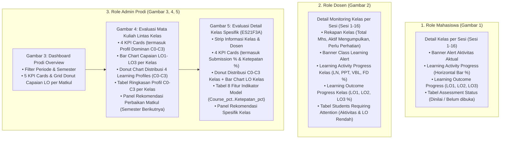
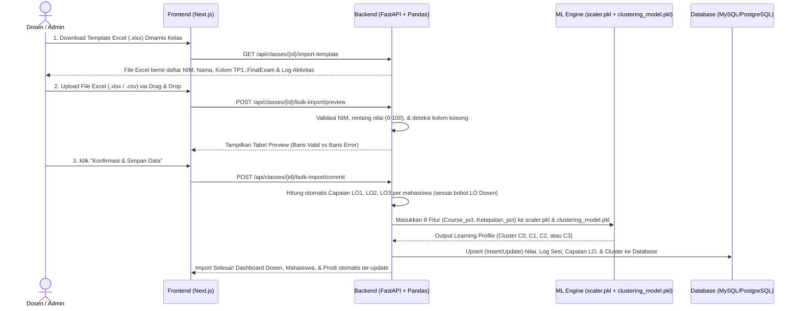

# 📘 Analisis Feedback Dosen, Bedah UI Baru (`UI Dashboard nm.docx`), RBAC, & Rancangan Ulang Database (v2.0)

Dokumen ini merangkum hasil analisis mendalam terhadap *feedback* terbaru dosen pemilik proyek, dokumen desain **[UI Dashboard nm.docx](file:///c:/laragon/www/pjj_binus/assets/UI%20Dashboard%20nm.docx)**, matriks **[Rekomendasi Prodi.xlsx](file:///c:/laragon/www/pjj_binus/assets/Rekomendasi%20Prodi.xlsx)**, serta evaluasi pemodelan **[Summary Modeling Clustering all.xlsx](file:///c:/laragon/www/pjj_binus/assets/Summary%20Modeling%20Clustering%20all.xlsx)**.

---

## 1. Bedah Perubahan Desain pada `UI Dashboard nm.docx` & Temuan Kunci

Berdasarkan ekstraksi 5 gambar desain terbaru di dalam `UI Dashboard nm.docx`, terdapat **evolusi penting** dibandingkan rancangan awal. Yang paling krusial: **ke-8 nama fitur asli pada model Machine Learning (`scaler.pkl` & `clustering_model.pkl`) kini terungkap secara eksplisit pada layar Detail Kelas Prodi!**

### A. Terungkapnya 8 Fitur Asli Model Machine Learning (`.pkl`)
Pada Gambar 5 (*Detail Kelas — ES21F3A*), tertulis bahwa model menggunakan **K-Means Clustering (`8 Fitur, RobustScaler`)** dengan rincian ke-8 fitur yang **100% cocok hingga angka desimalnya** dengan titik pusat `Cluster 0` di dalam file `clustering_model.pkl`:

| Urutan Fitur di `.pkl` | Nama Variabel Fitur | Label Indikator di UI | Median `scaler.pkl` (`center_`) | IQR `scaler.pkl` (`scale_`) | Nilai Centroid `Cluster 0` |
| :---: | :--- | :--- | :---: | :---: | :---: |
| **Fitur 1 (`X[0]`)** | `Course_pct` | Pengalaman Course / LMS | `77.14` | `6.80` | **`76.9%`** (`76.88`) |
| **Fitur 2 (`X[1]`)** | `Dosen_pct` | Pengalaman Teaching / Dosen | `78.10` | `6.29` | **`77.5%`** (`77.48`) |
| **Fitur 3 (`X[2]`)** | `FD_pct` | Aktivitas Forum Diskusi | `70.00` | `30.00` | **`69.9%`** (`69.88`) |
| **Fitur 4 (`X[3]`)** | `PPT_pct` | Akses Materi Presentasi | `70.00` | `20.00` | **`70.3%`** (`70.34`) |
| **Fitur 5 (`X[4]`)** | `LN_pct` | Akses Materi Learning / Navigasi | `70.00` | `20.00` | **`70.3%`** (`70.26`) |
| **Fitur 6 (`X[5]`)** | `VBL_pct` | Aktivitas Video Learning | `70.00` | `20.00` | **`69.9%`** (`69.94`) |
| **Fitur 7 (`X[6]`)** | `Submit_pct` | Penyelesaian Tugas (*Submission*) | `100.00` | `1.00` | **`100.0%`** (`100.00`) |
| **Fitur 8 (`X[7]`)** | `Ketepatan_pct` | Ketepatan Pengumpulan (*On-Time*) | `100.00` | `16.67` | **`93.1%`** (`93.07`) |

> [!IMPORTANT]
> Dari file `Summary Modeling Clustering all.xlsx` (Sheet `K-Means`, Baris 31), alasan tim ML memilih kombinasi **8 Features + Robust Scaler + K-Means ($K=4$)** adalah karena menghasilkan skor **Silhouette tertinggi (`0.84195`)** dan **Davies-Bouldin Index (DBI) terendah (`0.34072`)** dibandingkan seluruh algoritma lainnya (DBSCAN, HDBSCAN, GMM, Agglomerative).

---

### B. Matriks 4 Learning Profiles (`Rekomendasi Prodi.xlsx`)
Pada `UI Dashboard nm.docx` dan `Rekomendasi Prodi.xlsx`, output klaster `0, 1, 2, 3` dari `clustering_model.pkl` kini memiliki nama profil resmi dan rekomendasi strategis untuk Prodi:

| Kode Klaster | Nama Learning Profile | Warna UI | Karakteristik Empiris (`Rekomendasi Prodi.xlsx`) | Arahan & Fokus Rekomendasi Strategis (Semester Berikutnya) |
| :---: | :--- | :---: | :--- | :--- |
| **`C0`**<br>*(Cluster 0)* | **High Achievement & Consistent Engagement** | 🟢 Hijau | Rata-rata Total LO tertinggi, disertai *submission* dan ketepatan waktu yang tinggi. | **Maintain and Optimize Course Design**<br>1. Pertahankan struktur pembelajaran yang sudah berjalan.<br>2. Identifikasi LO yang masih bisa ditingkatkan. |
| **`C1`**<br>*(Cluster 1)* | **Critical Engagement & Assessment Support** | 🔴 Merah | Rata-rata Total LO terendah, disertai *engagement* forum & VBL serta *submission* dan ketepatan waktu yang rendah. | **Prioritize Course Redesign Review**<br>1. Evaluasi struktur *course* pada LMS, kualitas dan relevansi materi dengan LO.<br>2. Evaluasi kejelasan instruksi tugas.<br>3. Tinjau keselarasan materi–aktivitas–*assessment*. |
| **`C2`**<br>*(Cluster 2)* | **Developing Learning Engagement & LO Attainment** | 🔵 Biru | Rata-rata Total LO di bawah Cluster 0, dengan *submission* relatif tinggi dan *engagement* pada tingkat menengah. | **Improve Learning Effectiveness and Assessment Alignment**<br>1. Identifikasi LO yang relatif lebih rendah.<br>2. Tinjau keselarasan materi–aktivitas–*assessment* dengan LO.<br>3. Perkuat aktivitas Forum Diskusi dan VBL yang relevan dengan LO. |
| **`C3`**<br>*(Cluster 3)* | **Learning Engagement & Achievement Improvement** | 🟡 Kuning | Rata-rata Total LO relatif rendah, disertai *engagement* dan ketepatan waktu yang belum optimal. | **Improve Learning Activities and Course Structure**<br>1. Evaluasi urutan materi dan relevansinya dengan LO.<br>2. Tingkatkan kualitas Forum Diskusi menjadi ruang interaksi.<br>3. Evaluasi kejelasan instruksi dan rubrik penilaian tugas. |

---

### C. Bedah Detail 5 Layar Baru pada `UI Dashboard nm.docx`



#### Ringkasan Perubahan Penting per Role di `UI Dashboard nm.docx`:
1. **Dashboard Mahasiswa (Gambar 1)**:
   - **Tidak lagi menampilkan "Probabilitas Risiko %"** yang terkesan menghakimi mahasiswa, melainkan **Alert Aktivitas Konstruktif** (*"Perhatian: Tingkatkan Aktivitas Pembelajaran Anda — Aktivitas PPT dan penyelesaian asesmen Anda masih perlu ditingkatkan..."*).
   - Grafik aktivitas diubah menjadi **Horizontal Progress Bar (`%`)** + ditambahkan kartu baru **`Learning Outcome Progress`** (`LO1: 74`, `LO2: 18`, `LO3: —`).
   - Tabel kanan diubah menjadi **`Assessment Status`** yang menampilkan status **`Dinilai`** (hijau) atau **`Belum dibuka`** (oranye/abu-abu) untuk ke-9 komponen tugas/ujian.
2. **Dashboard Dosen (Gambar 2 — Sesuai 3 Poin Feedback Dosen)**:
   - **Memunculkan Rekapan**: Kartu 3 metrik di kiri atas (**`45 Mahasiswa`**, **`32 Aktif mengumpulkan`**, **`13 Perlu perhatian`**) bersanding dengan **`Class Learning Alert`**.
   - **Memantau Aktivitas Kelas & Capaian LO**: Dua kartu horizontal progress bar berdampingan: **`Learning Activity Progress`** (`LN 70%`, `PPT 59%`, `VBL 66%`, `FD 64%`) dan **`Learning Outcome Progress`** (`LO1 — Knowledge 74%`, `LO2 — Skills 58%`, `LO3 — Analysis 46%`).
   - **Memantau Mahasiswa yang Aktivitas / LO-nya Rendah**: Tabel bawah bernama **`Students Requiring Attention`** dengan kolom spesifik penyebabnya:
     - Kolom **`Aktivitas`**: misal *"Submission: 2 dari 6 tugas · Ketepatan: 1 dari 6 tugas"* atau *"Forum: 2 dari 10 sesi · VBL: 3 dari 10 sesi"*.
     - Kolom **`Asesmen`**: misal *"LO3 belum memiliki cukup bukti asesmen"* atau *"Capaian LO2 rendah (< 60)"*.
     - Kolom **`Status`**: Badge **`Perlu perhatian`** (Oranye) atau **`Monitoring`** (Biru).
3. **Dashboard Prodi (Gambar 3, 4, 5)**:
   - **Level Overview (Gambar 3)**: Menampilkan seluruh mata kuliah dengan filter `Periode` & `Semester` menggunakan Donut Chart 5 kategori (`Sangat Buruk` s/d `Sangat Baik`).
   - **Level Mata Kuliah (Gambar 4)**: Menampilkan distribusi jumlah & persentase mahasiswa pada **Cluster `C0, C1, C2, C3`** baik secara agregat (*Donut Chart 412 Mahasiswa*) maupun per kelas (`IS21F3A`–`IS21F3F`), serta menarik **Rekomendasi Perbaikan Mata Kuliah** dari `Rekomendasi Prodi.xlsx` berdasarkan klaster dominan.
   - **Level Kelas (Gambar 5)**: Menampilkan profil `C0–C3` untuk kelas tersebut, capaian `LO1, LO2, LO3`, nilai rata-rata **8 Fitur Model (`Course_pct` s/d `Ketepatan_pct`)**, serta rekomendasi spesifik yang menyebut langsung LO mana yang paling rendah di kelas tersebut (contoh: *"Identifikasi LO yang capaiannya relatif lebih rendah (dalam kelas ini: LO2 = 75,2)"*).

---

## 2. Alur Dinamis Input Learning Outcome (LO) oleh Dosen & Rekomendasi Bulk Import

Sesuai *feedback* dan catatan Anda:
1. *"Learning Outcome itu nanti akan di input oleh masing-masing dosen yang bersangkutan dengan mata kuliahnya."*
2. *"Untuk dosennya nanti dinamis saja."*
3. *"Rencana saya nanti data-data nilai untuk mahasiswa menggunakan bulk import saja (atau apapun itu nanti rekomendasikan saja mana yang baik)."*

### A. Alur Dosen Menginput & Memetakan Learning Outcome (LO) secara Dinamis
Karena setiap mata kuliah memiliki karakteristik LO yang berbeda dan dosen pengampu bersifat dinamis per semester/periode, sistem dirancang dengan alur **Konfigurasi LO & Pemetaan Bobot Asesmen**:

1. **Kelola Master LO Mata Kuliah / Kelas**:
   - Dosen yang ditugaskan mengampu suatu mata kuliah/kelas dapat menambahkan, mengubah, atau menyesuaikan daftar **Learning Outcome (`LO1`, `LO2`, `LO3`, hingga `LO-n`)** beserta judul dan deskripsinya (contoh: `LO1: Knowledge — Memahami konsep dasar ERP`, `LO2: Skills — Merancang proses bisnis`, `LO3: Analysis — Menganalisis studi kasus integrasi sistem`).
2. **Pemetaan Bobot Asesmen ke LO (*Assessment-to-LO Mapping Matrix*)**:
   - Dosen menentukan komponen asesmen mana (`TP 1`, `TP 2`, `TK 1`..`TK 4`, `Quiz 1`..`2`, `Final Exam`) yang berkontribusi ke `LO1`, `LO2`, `LO3` beserta persentase bobotnya dan dibuka pada sesi ke berapa (`unlock_session`).
   - Contoh matriks yang diinput dosen di UI:
     - `Tugas Personal 1` (Buka Sesi 3): `LO1 = 100%`, `LO2 = 0%`, `LO3 = 0%`
     - `Quiz 1` (Buka Sesi 7): `LO1 = 60%`, `LO2 = 40%`, `LO3 = 0%`
     - `Final Exam` (Buka Sesi 16): `LO1 = 30%`, `LO2 = 30%`, `LO3 = 40%`

### B. Rekomendasi Terbaik untuk Input Data Nilai & Aktivitas Mahasiswa: **Hybrid Bulk Import + Auto-Pipeline**

Menggunakan **Bulk Import (Excel `.xlsx` / CSV)** adalah **keputusan yang sangat tepat** untuk proyek kampus seperti BINUS karena data nilai dan log LMS jumlahnya ratusan hingga ribuan baris per mata kuliah (tidak mungkin diinput satu per satu secara manual).

Berikut adalah **Rekomendasi Arsitektur Bulk Import Terbaik** yang paling aman, *user-friendly*, dan minim error:



#### Mengapa Pendekatan **3-Tahap Bulk Import** Ini Paling Direkomendasikan?
1. **Generate Template Excel Otomatis per Kelas (`Download Template .xlsx`)**:
   - Dosen tidak perlu mengetik NIM dari nol atau bingung format nama kolom. Sistem menyediakan tombol **"📥 Download Template Nilai & Aktivitas (.xlsx)"** yang sudah berisi daftar NIM & Nama mahasiswa di kelas tersebut.
2. **Step Validasi & Preview Sebelum Simpan (*Staging Preview*)**:
   - Saat file Excel di-*upload*, sistem (menggunakan `pandas` / `openpyxl` di FastAPI) tidak langsung menimpa database, melainkan menampilkan **Preview 5 detik** di layar: *"45 mahasiswa terdeteksi valid, 0 error"*. Jika ada nilai di luar `0–100` atau NIM salah ketik, sistem memberi tahu baris mana yang salah.
3. **Fitur *Inline Edit* Cadangan**:
   - Setelah *Bulk Import* selesai, jika ada **1 atau 2 mahasiswa susulan** yang nilainya baru masuk, dosen tetap bisa mengedit nilai mahasiswa tersebut langsung di tabel UI (*inline edit*) tanpa harus meng-*upload* ulang seluruh file Excel.
4. **Auto-Compute LO & Auto-Trigger ML `.pkl`**:
   - Begitu data di-*import*, backend FastAPI otomatis:
     - Menghitung skor `LO1`, `LO2`, `LO3` tiap mahasiswa berdasarkan rumus bobot LO yang diinput dosen.
     - Menjalankan `scaler.pkl` + `clustering_model.pkl` untuk menentukan apakah mahasiswa tersebut masuk ke **`C0`, `C1`, `C2`, atau `C3`**.
     - Mengagregasi persentase `C0–C3` ke level **Kelas** dan **Mata Kuliah** untuk ditampilkan di **Dashboard Prodi** beserta rekomendasi dari `Rekomendasi Prodi.xlsx`.

---

## 3. Desain Sistem RBAC (*Role-Based Access Control*) & Cakupan Data

Karena sistem digunakan oleh banyak dosen, ratusan mahasiswa, dan pengelola Prodi, sistem memerlukan **RBAC Berbasis Role + Data Ownership Scoping** (bukan sekadar proteksi halaman, tetapi juga filter kepemilikan data di level query API):

### A. Matriks Hak Akses (RBAC Matrix)

| Modul / Fitur Sistem | 👨‍🎓 Mahasiswa (`student`) | 👨‍🏫 Dosen (`lecturer`) | 🏛️ Admin Prodi (`prodi_admin`) | 🛠️ Super Admin (`super_admin`) |
| :--- | :---: | :---: | :---: | :---: |
| **Login & Profil Akun (JWT Auth)** | ✅ | ✅ | ✅ | ✅ |
| **Lihat Dashboard & Alert Sesi Pribadi** | ✅ *(Hanya data dirinya)* | ❌ | ❌ | ✅ |
| **Lihat Status Asesmen & Progress LO Pribadi** | ✅ *(Hanya kelas yang diikuti)* | ❌ | ❌ | ✅ |
| **Kelola Definisi LO (`LO1..LOn`) & Bobot Asesmen** | ❌ | ✅ *(Hanya matkul/kelas yang diampu)* | 👁️ *(Read-only)* | ✅ |
| **Bulk Import Excel (`.xlsx`/`.csv`) Nilai & Aktivitas** | ❌ | ✅ *(Hanya kelas yang diampu)* | ❌ | ✅ |
| **Monitoring Kelas, Aktivitas Sesi & `Students Requiring Attention`** | ❌ | ✅ *(Hanya kelas yang diampu)* | 👁️ *(Lintas kelas)* | ✅ |
| **Dashboard Evaluasi Prodi (Filter Periode & Semester)** | ❌ | ❌ | ✅ *(Seluruh matkul di prodinya)* | ✅ |
| **Lihat Distribusi Klaster `C0–C3` & 8 Fitur Model ML** | ❌ | ❌ | ✅ | ✅ |
| **Lihat & Export Rekomendasi Strategis Prodi (`C0–C3`)** | ❌ | ❌ | ✅ | ✅ |
| **Kelola Master User, Dosen, Kelas, & Penugasan Dosen** | ❌ | ❌ | ✅ *(Lingkup Prodi)* | ✅ |

### B. Aturan Pembatasan Cakupan Data (*Data Scoping Rules* di Backend API)
1. **Scoping Mahasiswa (`role = student`)**:
   - Setiap endpoint `/api/student/*` mengambil `user_id` dari token JWT dan memfilter `WHERE enrollments.student_id = current_user.id`. Mahasiswa **tidak bisa** mengintip nilai atau status NIM mahasiswa lain.
2. **Scoping Dosen Dinamis (`role = lecturer`)**:
   - Dosen dihubungkan ke kelas melalui tabel `classes.lecturer_id` (atau tabel pivot `class_lecturers` jika *team teaching*).
   - Setiap endpoint `/api/lecturer/*` otomatis memfilter `WHERE classes.lecturer_id = current_user.id`. Dosen A hanya bisa melihat dan menginput LO/nilai untuk kelas yang ia ampu pada periode berjalan.
3. **Scoping Admin Prodi (`role = prodi_admin`)**:
   - Setiap user Prodi terikat ke `program_study_id` (misal: *Information Systems*). Endpoint `/api/prodi/*` menampilkan agregasi seluruh mata kuliah, kelas, dan dosen di bawah program studi tersebut.

---

## 4. Rancangan Ulang Struktur Database (`db_pjj_binus_v2`)

Struktur database dirancang ulang secara menyeluruh (**14 Tabel Terintegrasi**) agar mendukung:
1. **RBAC & Multi-Prodi** (`roles`, `program_studies`, `users`)
2. **Penugasan Dosen Dinamis & Periode Akademik** (`academic_periods`, `courses`, `classes`)
3. **Input LO Dinamis oleh Dosen & Bobot Asesmen** (`course_learning_outcomes`, `class_assessments`, `assessment_lo_weights`)
4. **Log Aktivitas Sesi, Nilai Asesmen, & Capaian LO Mahasiswa** (`enrollments`, `student_session_logs`, `student_assessment_scores`, `student_lo_attainments`)
5. **Output Machine Learning 8 Fitur (`Course_pct`..`Ketepatan_pct`) + Klaster `C0–C3` & Master Rekomendasi Prodi** (`student_ml_features`, `master_cluster_recommendations`, `bulk_import_logs`)

### A. Diagram Entity-Relationship (ERD v2.0)

```mermaid
erDiagram
    PROGRAM_STUDIES ||--o{ USERS : "memiliki"
    PROGRAM_STUDIES ||--o{ COURSES : "menaungi"
    ROLES ||--o{ USERS : "mengatur_akses"
    ACADEMIC_PERIODS ||--o{ CLASSES : "berlangsung_pada"
    COURSES ||--o{ CLASSES : "dibuka_dalam"
    USERS ||--o{ CLASSES : "dosen_mengampu (lecturer_id)"

    COURSES ||--o{ COURSE_LEARNING_OUTCOMES : "memiliki_definisi_LO"
    USERS ||--o{ COURSE_LEARNING_OUTCOMES : "diinput_oleh_dosen"

    CLASSES ||--o{ CLASS_ASSESSMENTS : "memiliki_komponen_tugas"
    CLASS_ASSESSMENTS ||--o{ ASSESSMENT_LO_WEIGHTS : "dipetakan_ke"
    COURSE_LEARNING_OUTCOMES ||--o{ ASSESSMENT_LO_WEIGHTS : "memiliki_bobot"

    USERS ||--o{ ENROLLMENTS : "mahasiswa_mengambil"
    CLASSES ||--o{ ENROLLMENTS : "memiliki_peserta"

    ENROLLMENTS ||--o{ STUDENT_SESSION_LOGS : "mencatat_sesi_1_16"
    ENROLLMENTS ||--o{ STUDENT_ASSESSMENT_SCORES : "memiliki_nilai_tugas"
    CLASS_ASSESSMENTS ||--o{ STUDENT_ASSESSMENT_SCORES : "dinilai_pada"

    ENROLLMENTS ||--o{ STUDENT_LO_ATTAINMENTS : "menghasilkan_capaian_LO"
    COURSE_LEARNING_OUTCOMES ||--o{ STUDENT_LO_ATTAINMENTS : "mengukur_LO"

    ENROLLMENTS ||--|| STUDENT_ML_FEATURES : "diprediksi_8_fitur_ML"
    MASTER_CLUSTER_RECOMMENDATIONS ||--o{ STUDENT_ML_FEATURES : "mereferensikan_C0_C3"
    CLASSES ||--o{ BULK_IMPORT_LOGS : "riwayat_upload_excel"

    ROLES {
        int id PK
        varchar role_code UK "student, lecturer, prodi_admin, super_admin"
        varchar role_name
        json permissions "Daftar izin akses modul"
    }

    PROGRAM_STUDIES {
        int id PK
        varchar code UK "IS, CS, BD"
        varchar name "Information Systems"
        varchar faculty
    }

    USERS {
        bigint id PK
        int role_id FK
        int program_study_id FK
        varchar identifier_number UK "NIM Mahasiswa / Kode Dosen / NIP"
        varchar full_name
        varchar email UK
        varchar password_hash
        boolean is_active
    }

    ACADEMIC_PERIODS {
        int id PK
        varchar period_code UK "2221, 2222"
        varchar academic_year "2022/2023"
        enum semester_type "Ganjil, Genap, Compact"
        boolean is_active
    }

    COURSES {
        int id PK
        int program_study_id FK
        varchar course_code UK "IS21F3, IS22G2"
        varchar course_name "Enterprise Systems"
        int credits
        int curriculum_year
    }

    COURSE_LEARNING_OUTCOMES {
        bigint id PK
        int course_id FK
        int academic_period_id FK "Opsional jika LO disesuaikan per periode"
        bigint created_by_lecturer_id FK "Dosen yang menginput LO"
        varchar lo_code "LO1, LO2, LO3"
        varchar lo_title "Knowledge, Skills, Analysis"
        text lo_description "Deskripsi kompetensi LO"
        decimal passing_threshold "Default 65.00"
    }

    CLASSES {
        bigint id PK
        int course_id FK
        int academic_period_id FK
        bigint lecturer_id FK "Dosen Pengampu Dinamis"
        varchar class_code "01PA, IS21F3A, ES21F3A"
        int total_sessions "Default 16"
        int dominant_cluster_id FK "Agregasi C0, C1, C2, atau C3"
        decimal avg_lo_score "Rata-rata LO Kelas (0-100)"
        timestamp last_ml_synced_at
    }

    CLASS_ASSESSMENTS {
        bigint id PK
        bigint class_id FK
        varchar assessment_code "TP1, TP2, TK1, TK2, TK3, TK4, Q1, Q2, FINAL"
        varchar assessment_name "Tugas Personal 1..Final Exam"
        int unlock_session "Dibuka pada Sesi ke-1..16"
        int due_session "Batas kumpul Sesi ke-1..16"
        decimal total_weight_pct "Bobot terhadap nilai akhir"
    }

    ASSESSMENT_LO_WEIGHTS {
        bigint id PK
        bigint class_assessment_id FK
        bigint lo_id FK
        decimal weight_pct "Bobot kontribusi tugas ke LO tersebut (0-100%)"
    }

    ENROLLMENTS {
        bigint id PK
        bigint class_id FK
        bigint student_id FK
        enum attention_status "normal, monitoring, perlu_perhatian"
        varchar attention_reason "Ringkasan otomatis untuk tabel Dosen"
    }

    STUDENT_SESSION_LOGS {
        bigint id PK
        bigint enrollment_id FK
        int session_number "Sesi 1 s/d 16"
        decimal ln_pct "Download Materi / LN (0-100%)"
        decimal ppt_pct "Lihat Handout / PPT (0-100%)"
        decimal vbl_pct "Video Learning / VBL (0-100%)"
        decimal fd_pct "Forum Discussion / FD (0-100%)"
        enum session_alert_level "safe, warning, critical"
        varchar session_alert_message
    }

    STUDENT_ASSESSMENT_SCORES {
        bigint id PK
        bigint enrollment_id FK
        bigint class_assessment_id FK
        enum status "belum_dibuka, belum_kumpul, dinilai"
        decimal raw_score "Nilai 0-100"
        boolean is_submitted "True jika dikumpulkan"
        boolean is_on_time "True jika tepat waktu"
        timestamp submitted_at
    }

    STUDENT_LO_ATTAINMENTS {
        bigint id PK
        bigint enrollment_id FK
        bigint lo_id FK
        decimal lo_score "Skor terhitung untuk LO1, LO2, LO3 (0-100)"
        boolean has_sufficient_evidence "False jika belum cukup asesmen"
    }

    STUDENT_ML_FEATURES {
        bigint id PK
        bigint enrollment_id FK "1-to-1 atau per snapshot evaluasi"
        decimal course_pct "Fitur 1 (X0): Pengalaman Course/LMS"
        decimal dosen_pct "Fitur 2 (X1): Pengalaman Teaching/Dosen"
        decimal fd_pct "Fitur 3 (X2): Aktivitas Forum Diskusi"
        decimal ppt_pct "Fitur 4 (X3): Akses Materi Presentasi"
        decimal ln_pct "Fitur 5 (X4): Akses Materi Learning/Navigasi"
        decimal vbl_pct "Fitur 6 (X5): Aktivitas Video Learning"
        decimal submit_pct "Fitur 7 (X6): Penyelesaian Tugas (%)"
        decimal ketepatan_pct "Fitur 8 (X7): Ketepatan Pengumpulan (%)"
        int assigned_cluster_id FK "Output KMeans: 0, 1, 2, atau 3"
        decimal euclidean_distance "Jarak ke centroid terpilih"
        timestamp predicted_at
    }

    MASTER_CLUSTER_RECOMMENDATIONS {
        int cluster_id PK "0, 1, 2, 3 (Sesuai Rekomendasi Prodi.xlsx)"
        varchar cluster_code "C0, C1, C2, C3"
        varchar profile_name "High Achievement and Consistent Engagement, dst."
        text empirical_characteristics "Karakteristik empiris dari Excel"
        varchar strategic_title "Maintain and optimize course design, dst."
        json action_items "Array butir fokus perbaikan semester berikutnya"
        varchar badge_color "green, red, blue, yellow"
    }

    BULK_IMPORT_LOGS {
        bigint id PK
        bigint class_id FK
        bigint uploaded_by_user_id FK
        varchar file_name
        int total_rows
        int success_rows
        int failed_rows
        enum import_status "preview, completed, failed"
        timestamp created_at
    }
```



---

### B. Penjelasan Kunci Bagaimana Skema Database Ini Menjawab Semua Kebutuhan Baru

1. **Tabel `course_learning_outcomes` & `assessment_lo_weights` (Menjawab Input LO oleh Dosen)**:
   - Dosen pengampu dapat membuat/mengedit daftar `LO1`, `LO2`, `LO3` pada mata kuliahnya serta mengatur bobot kontribusi tiap asesmen (`TP1..Final Exam`) terhadap masing-masing LO.
   - Saat nilai asesmen di-*import* ke `student_assessment_scores`, sistem otomatis menghitung nilai `student_lo_attainments` per LO dan rata-rata LO kelas!
2. **Tabel `student_ml_features` (Menjawab Integrasi Langsung dengan `scaler.pkl` & `clustering_model.pkl`)**:
   - Menyimpan persis **8 kolom fitur model** (`course_pct`, `dosen_pct`, `fd_pct`, `ppt_pct`, `ln_pct`, `vbl_pct`, `submit_pct`, `ketepatan_pct`) yang dibutuhkan oleh `scaler.pkl` dan `clustering_model.pkl`.
   - Menyimpan hasil prediksi klaster (`assigned_cluster_id` $\in \{0, 1, 2, 3\}$) sehingga grafik Donut **`Distribusi Learning Profiles (C0–C3)`** di Dashboard Prodi (Gambar 4 & Gambar 5) dapat di-*query* dengan sangat cepat (`SELECT assigned_cluster_id, COUNT(*) ... GROUP BY assigned_cluster_id`).
3. **Tabel `master_cluster_recommendations` (Menjawab File `Rekomendasi Prodi.xlsx`)**:
   - Menyimpan ke-4 baris dari `Rekomendasi Prodi.xlsx` (`Cluster 0`, `Cluster 1`, `Cluster 2`, `Cluster 3`) lengkap dengan judul strategis (*"Improve Learning Effectiveness and Assessment Alignment"*, dll.) dan butir-butir fokus perbaikannya.
   - Saat sebuah kelas atau mata kuliah memiliki klaster dominan tertentu (misal `C2 = 41.5%`), sistem otomatis menampilkan kartu rekomendasi `C2` beserta interpolasi LO terendah di kelas tersebut (seperti pada Gambar 5: *"dalam kelas ini: LO2 = 75,2"*).
4. **Tabel `enrollments` + `student_session_logs` + `student_assessment_scores` (Menjawab 3 Poin Dashboard Dosen)**:
   - **Rekapan Kelas**: Dihitung dari total baris `enrollments` (`45 Mahasiswa`), jumlah yang `submit_pct >= threshold` (`32 Aktif mengumpulkan`), dan jumlah yang berstatus `perlu_perhatian` (`13 Perlu perhatian`).
   - **Memantau Aktivitas Kelas**: Rata-rata `ln_pct`, `ppt_pct`, `vbl_pct`, `fd_pct` sampai sesi berjalan (`Sesi 7`).
   - **Memantau Mahasiswa LO Rendah / Kurang Aktif (`Students Requiring Attention`)**: Menampilkan mahasiswa yang memiliki `attention_status IN ('perlu_perhatian', 'monitoring')` lengkap dengan teks diagnosis otomatis (`Submission: 2 dari 6 tugas`, `LO3 belum memiliki cukup bukti asesmen`, atau `Skor LO2 rendah`).

---

## 5. Persiapan Tech Stack Final & Arsitektur Proyek

Untuk membangun sistem ini dari 0 agar **cepat selesai, mudah di-*maintain*, mendukung *Bulk Import Excel*, dan langsung menjalankan model `.pkl`**, berikut adalah Tech Stack yang kita gunakan:

### A. Stack Teknologi yang Direkomendasikan

| Layer | Teknologi | Alasan Pemilihan untuk Proyek PJJ BINUS |
| :--- | :--- | :--- |
| **Frontend Web** | **Next.js (React) + TypeScript + Tailwind CSS** | • Mendukung *App Router* & *Middleware* untuk proteksi halaman berdasarkan **RBAC** (`Mahasiswa`, `Dosen`, `Prodi`).<br>• Komponen UI cepat dibangun, responsif di HP & Laptop, dan mudah di-*deploy* ke **Vercel**. |
| **Visualisasi Grafik** | **Recharts** + **Lucide Icons** | • Sangat cocok untuk membuat *Donut Chart* (`C0–C3` & Matkul), *Grouped Bar Chart* (`LO1, LO2, LO3` lintas kelas), dan *Horizontal Progress Bar* persis seperti di `UI Dashboard nm.docx`. |
| **Backend API & ML Engine** | **Python FastAPI** | • **Native `.pkl` Support**: Langsung memuat `scaler.pkl` (`RobustScaler`) dan `clustering_model.pkl` (`KMeans`) di memori menggunakan `joblib` & `scikit-learn`.<br>• **Native Excel Bulk Import**: Menggunakan `pandas` & `openpyxl` untuk membaca dan memvalidasi ratusan baris Excel nilai mahasiswa dalam hitungan milidetik. |
| **ORM & Database** | **SQLAlchemy + MySQL 8.0 (Laragon) / PostgreSQL** | • Saat pengembangan lokal bisa langsung memakai **MySQL bawaan Laragon** Anda (`db_pjj_binus_v2`), dan saat produksi bisa menggunakan MySQL/PostgreSQL Cloud (Aiven / Supabase / Railway). |
| **Autentikasi & RBAC** | **JWT (JSON Web Token) + Passlib (Bcrypt)** | • Menyimpan `user_id`, `role_code` (`student`, `lecturer`, `prodi_admin`), dan `program_study_id` di dalam token untuk memfilter data secara otomatis. |

---

### B. Rencana Struktur Folder Proyek (`Full-Stack`)

```text
c:\laragon\www\pjj_binus\
├── assets\                                 # Dokumen referensi, logo BINUS, & Excel Rekomendasi
├── ml_models\                              # Menyimpan scaler.pkl & clustering_model.pkl
│   ├── scaler.pkl
│   └── clustering_model.pkl
├── backend\                                # Python FastAPI Server
│   ├── app\
│   │   ├── main.py                         # Entrypoint FastAPI & CORS
│   │   ├── core\
│   │   │   ├── config.py                   # Koneksi DB Laragon MySQL & JWT Secret
│   │   │   └── security.py                 # RBAC Middleware & JWT Dependencies
│   │   ├── models\                         # SQLAlchemy Models (14 Tabel Database v2)
│   │   ├── schemas\                        # Pydantic Schemas (Request/Response)
│   │   ├── services\
│   │   │   ├── ml_service.py               # Engine scaler.pkl + clustering_model.pkl
│   │   │   ├── lo_calculator.py            # Perhitungan otomatis LO1, LO2, LO3 dari bobot Dosen
│   │   │   └── bulk_import_service.py      # Generator Template .xlsx & Parser Upload Excel
│   │   └── routers\
│   │       ├── auth.py                     # Login & Profil RBAC
│   │       ├── student.py                  # API Dashboard Mahasiswa (Gambar 1)
│   │       ├── lecturer.py                 # API Dashboard Dosen, Input LO & Bulk Import (Gambar 2)
│   │       └── prodi.py                    # API Dashboard Prodi, Klaster C0-C3 & Rekomendasi (Gambar 3-5)
│   └── requirements.txt
└── frontend\                               # Next.js + Tailwind CSS Application
    ├── src\
    │   ├── app\
    │   │   ├── (auth)\login\               # Halaman Login Multi-Role
    │   │   ├── mahasiswa\                  # Halaman Role Mahasiswa (Gambar 1)
    │   │   ├── dosen\                      # Halaman Role Dosen + Modal Input LO & Bulk Import (Gambar 2)
    │   │   └── prodi\                      # Halaman Role Prodi Overview, Matkul, & Kelas (Gambar 3, 4, 5)
    │   ├── components\                     # Chart, Donut, Progress Bar, Sidebar BINUS
    │   └── lib\                            # API Client & RBAC Context
    └── package.json
```

---

## 6. Langkah Eksekusi Selanjutnya (Siap Dijalankan)

1. **Tahap 1 — Update Prototype HTML (`index.html` & `ml_visualization.html`) Sesuai `UI Dashboard nm.docx`**:
   - Memperbarui tampilan prototipe HTML Anda agar **100% identik dengan ke-5 gambar baru di `UI Dashboard nm.docx`** (termasuk penambahan form/modal **Input LO oleh Dosen**, simulasi **Bulk Import Excel**, tabel **`Students Requiring Attention`**, grafik **`Distribusi Learning Profiles C0–C3`**, tabel **8 Fitur Model (`Course_pct`..`Ketepatan_pct`)**, dan rekomendasi dari **`Rekomendasi Prodi.xlsx`**).
2. **Tahap 2 — Update File SQL (`database_schema.sql`) ke Versi 2.0**:
   - Memperbarui script DDL SQL dengan 14 tabel baru di atas beserta *seed data* `Rekomendasi Prodi.xlsx` (`Cluster 0, 1, 2, 3`).
3. **Tahap 3 — Eksekusi Build Aplikasi Full-Stack (`Next.js` + `FastAPI`)**:
   - Membangun aplikasi fungsional penuh dengan fitur RBAC, input LO dinamis oleh dosen, *Bulk Import Excel*, dan pemanggilan langsung `scaler.pkl` + `clustering_model.pkl`.

