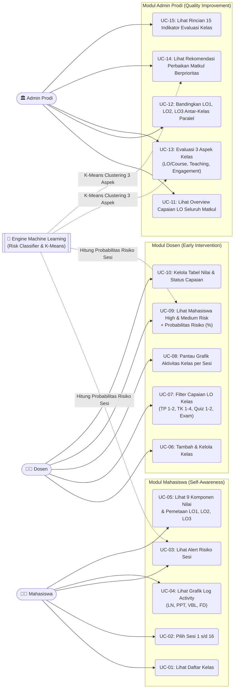
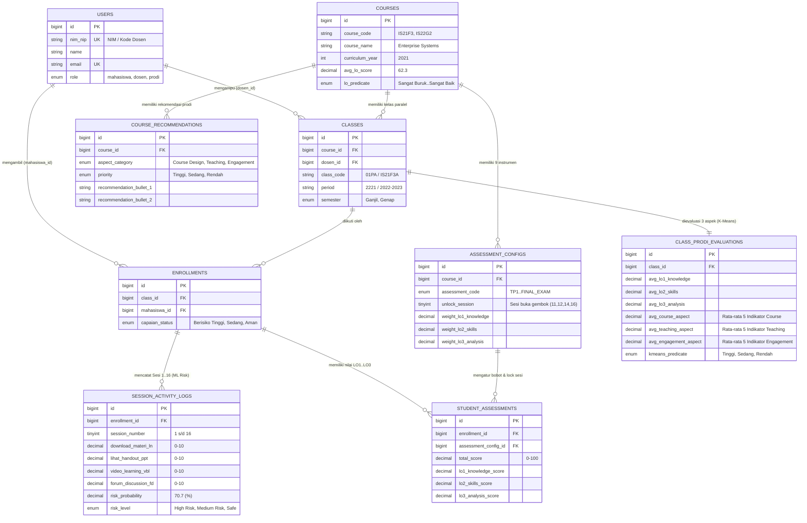

# Rancangan Use Case, ERD Database, & Arsitektur Sistem PJJ BINUS

Dokumen ini merupakan cetak biru (*blueprint*) teknis yang siap dipresentasikan kepada dosen pemilik proyek. Meskipun nantinya terdapat penyesuaian parameter dari tim Machine Learning atau dosen, struktur ini telah mengakomodasi **100% kebutuhan dari 7 tampilan referensi** (Mahasiswa, Dosen, dan Admin Prodi).

---

## 1. Pemetaan Use Case & Aktor Sistem

Sistem memiliki **3 Aktor Pengguna** dan **2 Modul Inferensi Machine Learning**:

### Tabel Spesifikasi Use Case Utama

| Kode | Nama Use Case | Aktor | Input Data | Output Sistem |
| :--- | :--- | :--- | :--- | :--- |
| **UC-03** | **Alert Risiko Sesi Mahasiswa** | Mahasiswa | Skor `LN`, `PPT`, `VBL`, `FD` pada sesi berjalan | Banner peringatan (*"Alert: Anda Berisiko Tinggi di Sesi X"*) jika partisipasi di bawah standar. |
| **UC-04** | **Visualisasi Log Activity** | Mahasiswa | Skor aktivitas LMS skala `0–10` | Grafik batang dengan kategori warna: **Poor** (Merah $\le 4$), **Average** (Kuning $5–7$), **Excellent** (Biru $\ge 8$). |
| **UC-05** | **Tabel 9 Nilai & Gembok Sesi** | Mahasiswa | Nilai `TP 1–2`, `TK 1–4`, `Quiz 1–2`, `Final Exam` | Rincian nilai per `LO1`, `LO2`, `LO3` atau status **🔒 Terkunci (Buka Sesi X)** jika sesi belum tercapai. |
| **UC-07** | **Analisis Capaian LO Kelas** | Dosen | Pilihan filter instrumen (`TP 1` s/d `Final Exam`) | Rata-rata nilai total kelas dan progress bar **LO1: Knowledge**, **LO2: Skills**, **LO3: Analysis**. |
| **UC-09** | **Deteksi Mahasiswa Berisiko** | Dosen | Log LMS sesi aktif + histori capaian LO | Daftar mahasiswa **High Risk** & **Medium Risk** beserta **Probabilitas Risiko (%)** dan rincian skor `FD`, `LN`, `PPT`, `VBL`. |
| **UC-12** | **Komparasi Kelas Paralel** | Prodi | Kode Mata Kuliah (`IS21F3`), Periode, Semester | Grafik batang perbandingan `LO1`, `LO2`, `LO3` antar 6 kelas (`IS21F3A`–`F`) terhadap garis rata-rata matkul. |
| **UC-13** | **Evaluasi 3 Aspek & K-Means** | Prodi | 15 indikator (*Course*, *Teaching*, *Engagement*) | Predikat klaster kelas (**Tinggi $\ge 75$**, **Sedang $65–74$**, **Rendah $< 65$**) dan rekomendasi perbaikan berprioritas. |

---

## 2. Rancangan Entity Relationship Diagram (ERD) Database

Berikut adalah struktur relasi antar-tabel (**9 Tabel Relasional**) yang telah dituangkan ke dalam file `database_schema.sql`:

---

## 3. Kamus Data Ringkas: 15 Indikator Evaluasi Kelas (Tabel `class_prodi_evaluations`)

Untuk mendukung **Layar 7 (Detail Kelas di Prodi)** secara presisi, tabel `class_prodi_evaluations` menyimpan 3 kelompok aspek berikut:

1. **Aspek 1: Learning Outcome (LO) / Course Design**
   * `course_goal_clarity`: Kejelasan Tujuan Pembelajaran (`82.3%`)
   * `course_material_quality`: Kualitas Materi (`79.1%`)
   * `course_lo_alignment`: Kesesuaian Materi dengan LO (`76.4%`)
   * `course_learning_activity`: Aktivitas Pembelajaran (`75.6%`)
   * `course_evaluation_instrument`: Evaluasi & Penilaian (`74.2%`)
2. **Aspek 2: Capaian Teaching (Pengajaran Dosen)**
   * `teaching_delivery_clarity`: Kejelasan Penyampaian (`81.5%`)
   * `teaching_material_mastery`: Penguasaan Materi (`83.2%`)
   * `teaching_interaction`: Interaksi & Komunikasi (`78.9%`)
   * `teaching_feedback_timeliness`: Pemberian Umpan Balik (`76.4%`)
   * `teaching_class_management`: Pengelolaan Kelas (`72.5%`)
3. **Aspek 3: Capaian Engagement (Partisipasi LMS Mahasiswa)**
   * `eng_vbl_live_attendance`: Kehadiran VBL & Sesi Live (`84.1%`)
   * `eng_forum_participation`: Partisipasi Forum Diskusi (`68.3%`)
   * `eng_ontime_submission`: Upload/Submit Tugas Tepat Waktu (`74.6%`)
   * `eng_material_access`: Akses Materi PPT, Modul, dll. (`81.2%`)
   * `eng_video_duration`: Durasi Belajar Video Learning (`77.5%`)

